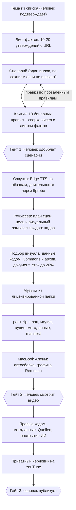

# План: как доделать завод Machtwechsel дёшево и чтобы ролики были хорошими

Дата: 27.10.2026. Для агента Алёны (Claude Code на её сервере) и для самой Алёны. Сергей передаёт завод, чтобы дальше его развивали на её токенах.

Порядок чтения: сначала `HANDOFF.md` (что в репозитории и как запускать), потом этот файл (что делать и в каком порядке), потом по мере работы:
- `docs/GAP-ANALYSIS.md`: подробная сверка старого завода с новым по каждому этапу, экономика с источниками, ограничения её сервера, риски, топ-10 изменений.
- `docs/tainy-essence/`: как устроен Tainy, завод Сергея, который делает хорошие ролики. Режиссура, сценарий и критик, графика кодом, оркестрация, расходы, уроки. Там же копии ключевых промптов (`prompts/`) и исходники композиций (`render-src/`).

## 1. Цель и рамки

- Канал: Machtwechsel, немецкий, финансы и истории компаний (взлёт и крах). Ролики 15-22 минуты, 1-2 в неделю.
- Сейчас на канале 14 роликов и 3,5 тысячи просмотров всего. Лучшие ролики (Volkswagen, Neuseeland) набрали по 1200-1500 просмотров. Выбор темы и первые минуты важнее оптимизации мелочей.
- Дёшево. Допущение, пока Сергей не назвал свой потолок: платных вызовов (деньги) не больше 1 $ на ролик и 20 $ в месяц. Основной ресурс Алёны это токены её подписки Claude и её часы, поэтому план режет прежде всего их. Потолок меняет только Сергей или Алёна.
- Хорошо. Планка качества это Tainy: сильный хук, открытые вопросы, режиссура кадров, цифры на экране только те, что звучат в голосе.
- Полуавтомат. Человек подтверждает тему, сценарий и готовое видео. Публикация только после её «да».

## 2. Принципы

1. Лёгкое на сервере, тяжёлое на MacBook Алёны. Сервер 2 ГБ памяти и 1 процессор: он пишет текст, озвучивает, раскладывает кадры и собирает пакет. Монтаж, Remotion, перекодирование, Chromium идут на Mac (так уже сделан Tainy: `pack.zip` и скрипт сборки на Mac).
2. Агент это режиссёр и оркестратор, а не рабочая лошадка. Тяжёлые стадии он запускает отдельной службой systemd с лимитом памяти и сразу возвращает управление. Рендер внутри чата бота однажды повесил агента Сергея на 13 часов. Подробности и шаблон службы: `docs/GAP-ANALYSIS.md`, раздел 4.2.
3. Проверка кодом дешевле проверки моделью. Что можно проверить кодом (длина, непрерывность таймлайна, цифры и даты, файлы на месте), проверяется кодом. Модель зовётся там, где нужен смысл.
4. Платное по умолчанию выключено. Озвучка, картинки и всё остальное платное включается явным параметром, а не дефолтом.
5. Деньги и токены считаются до траты. Перед платным этапом проверяется остаток бюджета, каждая стадия пишет расход в журнал (идея `tainy/pipeline/budget.py`).
6. Ничего не публикуется само. Только загрузка приватным черновиком, публикует человек.
7. Источники в каждом ролике. Каждое число и дата сценария либо подтверждены источником с ссылкой, либо помечены как неподтверждённые. Финансовый канал без этого получит претензии и санкции.
8. Секреты только через настройки агента. Значения ключей не печатать, не писать в файлы и в чат.

## 3. Целевая схема

Все этапы до `pack.zip` идут на сервере. Всё после идёт на Mac. Подробная схема Tainy с тем, где платно: `docs/tainy-essence/00-OVERVIEW.md`.

## 4. Роли и оркестрация

Роли это разные вызовы одной модели с разными промптами и контрактами. Контракт между этапами это файл в папке задачи (JSON), а не пересказ в чате. Схема взята из Tainy (`docs/tainy-essence/04-ORCHESTRATION.md`).

| Роль | Делает | Вход, выход | Модель |
|---|---|---|---|
| Исследователь | собирает 10-20 проверяемых утверждений с URL | тема, `facts.json` | Sonnet, один вызов |
| Автор | пишет сценарий по структуре: хук, открытые петли, главы, финал | факты, `script.json` | Sonnet |
| Критик | 18 бинарных правил (11 считает код, 7 судит один вызов), цитата на каждое решение, сверка чисел с фактами | сценарий, `critic.json` | Haiku или Sonnet, один вызов |
| Режиссёр | раскладывает текст по сценам, для каждой пишет цель и визуальный замысел | сценарий, тайминги, `scene_plan.json` | Sonnet |
| Подборщик визуала | ищет данные, фото Commons, документ, сток под сцену, записывает автора и лицензию | план сцен, `media_manifest.json` | код плюс редкие вызовы Haiku |
| Контроль | проверяет план и файлы кодом: непрерывность таймлайна, длительности, цифры на экране звучат в голосе | всё выше, `qa.json` | код |
| Упаковщик | собирает `pack.zip` и `manifest.json` | всё выше | код |

Как агент ими управляет:
- Единая команда `factory.py` (см. приоритет 2 ниже): `new <тема>`, `status`, `approve-script`, `pack`, `cleanup`. Одобрение сценария и видео через файл `approval.json` в папке задачи, а не через веб-интерфейс.
- Каждая стадия идёт отдельной службой systemd с лимитом памяти и временем жизни. Один ролик за раз (`flock`). Чекпоинт после каждой стадии, упавшая стадия перезапускается с места.
- Агент читает `status` и отчёты (`facts-report.md`, `critic.json`, `qa.json`) и коротко докладывает Алёне, а не гоняет процесс в чате.
- Экономия токенов подписки: короткие промпты, готовые структуры из файлов, Haiku на проверках и метаданных, Sonnet на сценарии и режиссуре, никаких Opus-проходов, кэширование неизменных частей промпта, пакетные вызовы (подробности в `docs/GAP-ANALYSIS.md`, раздел 4.3).

## 5. Что оставить, заменить, добавить, убрать

Подробные обоснования с путями файлов: `docs/GAP-ANALYSIS.md`, раздел 2.

1. Тема: оставить поиск тем, но брать темы из списка `docs/legacy-de/DE_CHANNELS_AND_REFERENCES.md` (Wirecard, CumEx, Signa, P&R и другие) и сверять с уже вышедшим.
2. Сценарий: заменить длинную цепочку «судья, правки, humanize, virality» на один вызов сценария, проверки кодом и одну точечную правку по списку проваленных правил.
3. Критик и проверка фактов: заменить рубрику с оценками 1-10 на 18 бинарных правил Tainy (формулировки переписать под финансы), добавить лист фактов с источниками и сверку чисел. Этого нет ни в старом заводе, ни в Tainy.
4. Озвучка: дефолт заменить на дешёвый (Edge TTS), платный ElevenLabs оставить как выбор. Озвучивать по абзацам и брать длительности `ffprobe`.
5. Выравнивание: заменить Deepgram на тайминги по построению (длительности кусков). Deepgram не нужен.
6. План сцен и режиссура: оставить промпт `plan_scenes` (он уже финансовый), добавить дешёвые проверки Tainy кодом.
7. Визуал: поменять приоритет источников: данные кодом, затем Commons и архив с автором и лицензией, затем снимок документа, затем сток не больше 20%, ИИ только абстрактные фоны. Убрать режим stick_figure, Seedream и Flux для Machtwechsel (стикмены на немецком не зашли).
8. Музыка: заменить. Папка `assets/music/` и `LICENSES.md` в репозитории, микс из Tainy (`mix.py`).
9. Сборка: заменить ручной DaVinci на пакет и автосборку на Mac.
10. Превью: добавить, фон плюс немецкий заголовок 2-4 слова, наложенный кодом (ИИ путает умлауты и ß).
11. Метаданные: оставить, добавить блок «Quellen», проверку тегов и строку о раскрытии использования ИИ.
12. Шортсы: добавить позже и урезанно (2 на ролик), только после основных пунктов.
13. Управление: убрать React и Railway, добавить CLI `factory.py` и файловое одобрение.
14. Публикация: сначала руками по готовому `PUBLISH_de.md`, после 3-5 роликов загрузка приватным черновиком через API.
15. Хранилище и очередь: заменить `queue.json` на папку задач с `job.json`, раздачу пакета на Mac сделать по HTTPS с её сервера.

Что сознательно не берём из Tainy: дубляж на 6 языков, Opus как писатель, русские лексиконы проверок, vision-проверку каждого кадра, три провайдера озвучки с переключением. Список и причины: `docs/GAP-ANALYSIS.md`, конец раздела 6.

## 6. Порядок работ и критерии готовности

Приоритеты из `docs/GAP-ANALYSIS.md`, раздел 6, там же трудоёмкость и зависимости. После каждой фазы коммит в ветку, запись в `NEXT.md`, короткий отчёт Алёне.

Фаза 0. Основа и безопасность.
- Профиль Machtwechsel вернуть по `HANDOFF.md`, раздел 0 (приоритет 1), отделив канал от языка: профиль Nina не трогать.
- Запуск стадий отдельной службой с лимитами, `factory.py`, атомарная очередь (приоритет 2).
- Готово, когда: запуск из чата возвращается за секунды, процесс виден как отдельная служба, повторный запуск отказывает.

Фаза 1. Тестовый ролик на 3 минуты без платных вызовов.
- Сценарий через подписку Алёны (приоритет 3), озвучка Edge TTS с таймингами по построению (приоритет 4), визуал из Commons и стока (часть приоритета 6), музыка из лицензированной папки (приоритет 7).
- Результат: `pack.zip` и сборка на Mac.
- Готово, когда: ролик на 3 минуты собирается без единого платного вызова и без ключа Deepgram, сумма длительностей кусков равна длине озвучки, на Mac из пакета одной командой выходит mp4 1920x1080.

Фаза 2. Качество сценария.
- Лист фактов и сверка чисел, критик на 18 правилах (приоритет 5).
- Готово, когда: каждое число и дата сценария либо есть в `facts.json` с URL, либо стоит в отчёте как «не подтверждено», а прогон по теме Wirecard не пропускает неподтверждённых цифр в «готов».

Фаза 3. Картинка и графика кодом.
- Композиции Remotion для финансов из `docs/tainy-essence/render-src/` и старого `remotion/`: линейный график, столбцы, счётчик, таймлайн, газетный заголовок, документ с выделенной цитатой (приоритет 6 целиком), превью кодом (приоритет 9).
- Готово, когда: не менее 60% кадров имеют источник из набора «данные, Commons, документ», у каждого файла из Commons записаны автор и лицензия, превью проходят проверку текста кодом.

Фаза 4. Звук, метаданные, загрузка.
- Микс музыки (приоритет 7), метаданные с Quellen и раскрытием ИИ, загрузка приватным черновиком (приоритет 10).
- Готово, когда: громкость в диапазоне от минус 16 до минус 14 LUFS, в описании есть Quellen и раскрытие, команда загрузки создаёт приватный черновик и ничего не публикует.

Фаза 5. Полный ролик и обкатка.
- Полный ролик на 22 минуты, затем 3-5 роликов подряд с разбором, что дало просмотры. Шортсы после этого.
- Готово, когда: три ролика подряд прошли весь путь без ручной правки кода, а расход на ролик держится в бюджете.

## 7. Деньги и токены

- Сколько стоило раньше и откуда цифры: `docs/GAP-ANALYSIS.md`, раздел 3, и `docs/tainy-essence/05-COSTS.md`. Пилот июня 2026 (Massenflucht, 22 минуты): 3,53 $ (озвучка 1,88 $, LLM около 0,95 $, проверка Opus 0,70 $, Deepgram 0,10 $).
- Дешёвый режим по расчёту: около 0,2-0,6 $ на ролик (Gemini Flash-Lite TTS и до 40 ИИ-иллюстраций). Бесплатный режим: 0 $ деньгами, Edge TTS, тайминги по построению, Commons и сток, музыка из Audio Library, превью кодом, расход только токенами подписки. Качество озвучки в бесплатном режиме ниже.
- В Tainy расходы выросли, когда включили API-кредиты (5 дней по журналу дали заметную сумму), поэтому в Machtwechsel LLM идёт по подписке, а не через API.
- Журнал расходов `logs/spend.jsonl`: сервис, единицы, оценка денег, на каждую стадию. Первый прогон нужен, чтобы измерить реальные токены: оценки в анализе грубые.

## 8. Что нельзя и грабли

- Не запускать `autorun.py` и `pytest` как есть: часть тестов (`tests/test_pipeline_phases.py`, `test_gonka.py`, `backend/tests/test_pipeline.py`) ходит в платные API и тратит деньги. Сначала тесты без внешних вызовов.
- Не запускать веб-API завода на этом сервере (держит все задачи в одном процессе, не влезает в память).
- Не включать Seedream и Flux по умолчанию. Профиль Nina использует стикменов и платные картинки, Machtwechsel нет.
- Не использовать `Kimi-K2.6` на шлюзе Gonka, не проверив живым запросом: на 27.10 её нет в списке шлюза (`docs/GAP-ANALYSIS.md`, раздел 3.4).
- Не заливать на Drive целый zip через память (`delivery.py`): zip в e2e весил 1,83 ГБ. Раздавать пакет по HTTPS.
- Не публиковать видео без её «да», не включать автозагрузку как публикацию.
- Не вставлять целиком `script-de.md` (16,6 КБ) в каждый из примерно 12 секционных вызовов сценария (`script.py`, около строки 446): это главная утечка токенов подписки. Давать краткий контракт и ссылку на структуру, полный текст один раз.
- Не копировать из Tainy то, что дорого: у него 128-191 вызовов и 6,7-10,3 $ по API-прайсу за ролик. Брать только дешёвое: бинарные правила кодом, точечные замены, кэш, пакет для Mac, предпроверку бюджета.
- Не доверять «1020 единиц на discover» из `HANDOFF.md`: по странице Google от 15.10.2026 `search.list` и `videos.insert` имеют отдельные лимиты по 100 вызовов в сутки.
- Coverr убрать из цепочки стоков (двусмысленные условия про коммерческое использование). Voyage не подключать: в коде он не вызывается.
- Не печатать значения ключей, не класть ключи в репозиторий (`.env` игнорируется).

## 9. Риски канала и правила, без которых канал получит санкцию

Подробно, со ссылками на справку YouTube и немецкое право, проверено 27.10.2026: `docs/GAP-ANALYSIS.md`, раздел 5. Юридические пункты это ориентир из открытых источников, а не консультация: для канала про реальных людей и компании нужен медиа-юрист в Германии. Девять правил, каждое проверяется кодом или явным шагом человека:

1. Свой тезис. В записи очереди обязательны поля `thesis` (одна мысль, которую доказывает ролик) и `original_value` (что зритель получает, чего нет в первоисточниках: сводная хронология, график по данным, сравнение). Без них `factory.py new` не запускается.
2. Источники. `facts.json` с URL, блок «Quellen» в описании, отчёт `facts-report.md`. Для чисел на экране подпись источника.
3. Ручная правка. Человек, владеющий немецким, читает сценарий и отчёт и ставит `approval.json`. Число правок пишется в журнал. Одобрение без правок несколько роликов подряд это тревожный сигнал.
4. Темп. Не больше 1-2 роликов в неделю, лимит в конфиге (`max_publish_per_week`). Ежедневный cron из `deploy/` отключить.
5. Разнообразие. Чередовать структуры (хронология, расследование, сравнение) и обороты в названиях. Не клонировать один ролик на несколько языков.
6. Раскрытие. В описании строка об ИИ-озвучке и иллюстрациях, в Studio «AI use: Да», если есть реалистичные ИИ-картинки или синтетический голос.
7. Видеоряд. Без узнаваемых лиц под обвинением, без читаемых логотипов, ИИ только абстрактный, у каждого файла из Commons записаны автор и лицензия. Pexels и Pixabay запрещают показывать узнаваемых людей «в плохом свете».
8. Проверка перед публикацией: `publish-checklist.md` в каждой задаче (факты, формулировки о людях, лицензии кадров и музыки, раскрытие, метаданные).
9. Не публиковать пачкой и не перезаливать ролики массово после жалоб: сначала разобраться, при демонетизации смотреть «Reused» и «Inauthentic» в Studio.

Особо для финансового канала:
- В `backend/prompts/script-de.md` сейчас нет защиты от обвинений. Добавить: презумпция невиновности, «mutmaßlich», «laut Gericht», различать установленный факт и подозрение. Пока этого нет, темы про живых людей и незакрытые дела не брать.
- Никаких инвестиционных советов и призывов «что купить»: нельзя и по правилам YouTube (ИИ-персона даёт финансовые советы), и по немецкому регулированию.
- Чужие транскрипты конкурентов (`fetch_transcripts`, `script._build_source_context`) из боевого пути убрать: это основной сценарий нарушения правила «reused content».
- Сценарий пишется из фактов нескольких первичных источников, а не пересказом одной статьи.

## 10. Как докладывать и вести работу

- `NEXT.md` в корне: цель, что сделано, чем проверено, следующий шаг, ветка и коммит. Без секретов.
- Алёне коротко: что готово, что ждёт её решения, сколько потрачено токенов и денег. Сложное объяснять схемой.
- Вопрос Сергею или Алёне задавать, когда без них нельзя дальше (потолок бюджета, голос, выбор тем, публикация). Остальное решать самому по этому плану.
- Менять сам план можно: записывай, что поменял и почему, в конец этого файла.

## 11. Открытые вопросы

- Потолок бюджета на ролик и в месяц (в плане стоит допущение 1 $ и 20 $).
- Какой голос для озвучки на немецком. Образцы лежат в `youtube-longform/free-stack-tests/` на сервере Сергея (передать Алёне, если нужно).
- Какие темы первые: список в `docs/legacy-de/DE_CHANNELS_AND_REFERENCES.md`.
- Работает ли Edge TTS у её провайдера и как звучит `de-DE-FlorianMultilingualNeural` на длинном тексте: проверить на тестовом ролике.
- Есть ли на её Mac DaVinci или хватит автосборки; какие шаблоны motion нужны (в репозитории шаблонов нет). Судя по заметкам Tainy, она уже рендерит на своём MacBook скриптом Tainy (`docs/tainy-essence/render-src/mac/`): сначала проверить, можно ли взять тот же сборщик, а не писать новый.
- Загрузка через API: справка YouTube 7300965 говорит, что ролики из непроверенных сервисов блокируются в private без апелляции, а страница `videos.insert` пишет обратное. Какой текст верен, неизвестно: проверить на одном тестовом ролике, пока оставить загрузку ручной.
- Работает ли `Kimi-K2.6` на шлюзе Gonka: по плану не нужна (LLM идёт по подписке), но старый конфиг на неё настроен, один живой запрос это покажет.
- Нужен ли медиа-юрист в Германии для тем про живых людей и незакрытые дела: это решение Алёны и Сергея.
- Всё, что в `docs/GAP-ANALYSIS.md` помечено «нет данных»: цены Voicer, скорость Piper и faster-whisper на 1 vCPU, суточные лимиты бесплатного Gemini TTS. Проверять живыми запросами на тестовом ролике.
