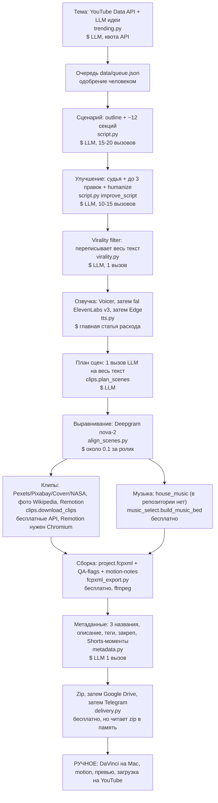

# GAP-ANALYSIS: Machtwechsel (youtube-factory) против Tainy, экономика и приоритеты

Дата: 2026-10-27. Состав: 1 состояние, 2 сверка по этапам, 3 экономика с ценами из сети, 4 среда Алёны, 5 риски и политика YouTube, 6 приоритеты. Связанные документы: `PLAN-CHEAP-FACTORY.md` (план работ, при расхождении прав он), `docs/tainy-essence/` (устройство Tainy).
Правила проверки: утверждения про код даны с путями относительно корня репозитория; предположения помечены «предположение»; цен, которых не нашёл, не выдумываю: «нет данных».

## 1. Состояние старого завода одним экраном

Источники: код ветки `integrate` (читал, не запускал), `HANDOFF.md`, `docs/AUDIT.md`, `docs/e2e-issues.md`, `ARCHITECTURE.md`. Где доки расходятся с кодом, верю коду и помечаю расхождение.

### 1.1. Что реально работает (по коду)

- Каркас фаз с чекпоинтом: `backend/pipeline/orchestrator.py` (`Pipeline.run`, 11 фаз, `VideoTask.save_checkpoint` теперь мерджит и пишет атомарно через temp+rename). Блокер AUDIT №5 закрыт.
- LLM-клиент с ретраями и фолбэком, пустой ответ не возвращается как `None`: `backend/utils/llm.py` (`call_llm`). Блокер AUDIT №6 закрыт. Но фолбэка по сути нет: в `backend/config/models.yaml` у 10 из 11 задач `primary` и `fallback` равны `moonshotai/Kimi-K2.6` (Gonka), у `vision_scoring` фолбэка нет вовсе, то есть при падении шлюза падает всё.
- Склейка озвучки без наложения: `backend/pipeline/tts.py` (`_concatenate_audio` через `concat` + пауза, стерео). Блокер AUDIT №1 закрыт; `docs/e2e-issues.md` подтверждает прогон: голос встык, 794 с.
- Выравнивание сцен по словам Deepgram с запасным пропорциональным режимом и проверкой покрытия: `backend/pipeline/align_scenes.py` (`realign_scene_plan`), `orchestrator._phase_alignment`.
- Проверка скачанных клипов (ffprobe + приведение к 1920x1080 без звука): `backend/stock/multi.py` (`_is_valid_video`, `_sanitize_clip`). Блокер AUDIT №3 закрыт.
- FCPXML без чёрного хвоста: `backend/pipeline/fcpxml_export.py` (`_build_video_spine` кладёт клип до старта следующей сцены, кадрово-непрерывно, плюс зацикливание последнего клипа). Расхождение с доками: `docs/e2e-issues.md` пункт 4 числит это «отложено», в коде уже исправлено; тесты `tests/test_av_coverage.py` это покрывают (имена `test_spine_contiguous_no_gaps` и др.).
- Реальные главы YouTube из тайминга сцен: `orchestrator._chapters_from_aligned_plan` (раньше LLM выдумывал таймкоды).
- Дедуп тем по уже опубликованному: `backend/config/__init__.py` (`get_published_titles`, YouTube Data API по ключу, кэш 12 ч).

### 1.2. Полуавтомат (человек на каждом выпуске)

- Одобрение темы в `data/queue.json` (`autorun.py`: статусы `pending_approval` -> `approved`). Гейт одобрения сценария есть только в веб-API (`backend/api/main.py`: `POST /scripts`, `POST /videos/{id}/approve`); `autorun.py` гонит конвейер от темы до zip без остановки на сценарии.
- Монтаж и motion: DaVinci по `project.fcpxml` + `QA-flags.md` + `motion-notes.md`. Шаблонов motion/Fusion владельца в репозитории нет (`HANDOFF.md` §4).
- Превью: автогенерация выключена (`orchestrator._phase_metadata`, блок `if False and ...`), человек делает по промптам из `PUBLISH_de.md`.
- Загрузка на YouTube: кода нет вообще (`HANDOFF.md` §5; в `backend/` нет ни `videos.insert`, ни OAuth канала).
- Доставка: zip в Google Drive или скачивание с сайта (`backend/pipeline/delivery.py`).

### 1.3. Сломано, не реализовано или лежит мёртвым грузом

1. Профиль Machtwechsel удалён: `backend/config/channels.yaml` содержит `de` = «Nina» (`niche: curiosity_history`, `visual_mode: stick_figure`, id `UCVZZnW0SO_AAWqQCfTbgRPg`). Эти поля читают `script.py` (бренд-контракт судьи, ветка `is_curiosity`), `metadata.py` (`get_channel_config`), `orchestrator._phase_music` и дедуп `get_published_titles`. Поэтому запуск `--lang de` сейчас делает сценарий в тоне «тёплого эссе про древних людей», а не финансовых расследований, а дедуп сверяется не с тем каналом. Через веб-API `_resolve_visual_mode` (`backend/api/main.py`) для `de` берёт `stick_figure` из этого же профиля, то есть платные картинки Seedream вместо стоков; `autorun.py` создаёт `VideoTask` с дефолтом `visual_mode="pexels"`. Восстановить блок надо из коммита `b566bf4` (`HANDOFF.md` §0).
2. Музыки нет: `orchestrator._phase_music` берёт пул из `assets/house_music` или `data/house_music`; обе папки в `.gitignore` и в рабочей копии отсутствуют, поэтому `build_music_bed` не вызывается и `task.music_path = None` (видео без музыки, в логе предупреждение). Код Freesound (`pipeline/music.py`, `music_select.py`) оркестратор не вызывает.
3. Заявлено, но не реализовано: vision-оценка релевантности клипа (`models.yaml: vision_scoring`, в `backend/` нет ни одного вызова), факт-чек (`models.yaml: fact_check`, нет ни одного вызова), Voyage-эмбеддинги (`VOYAGE_API_KEY` в `HANDOFF.md`, но `grep voyage` по `backend/` пуст).
4. `fetch_transcripts` (`scrapers/trending.py`) и `_build_source_context` (`pipeline/script.py`) умеют подмешивать в промпт чужие транскрипты как «факты и структуру». В боевой цепочке `autorun.py` они не вызываются, но в API (`source_transcript`) путь жив. Это риск повторного использования чужого контента (раздел 5).
5. Выгрузка в Drive читает весь zip в память и ещё раз склеивает тело: `backend/pipeline/delivery.py` (`upload_zip_to_gdrive`: `body += zip_path.read_bytes()`). Размер zip в e2e был 1,83 ГБ (`docs/e2e-issues.md`), то есть на сервере с 2 ГБ памяти этот шаг гарантированно убивает процесс (блокер надёжности из AUDIT не закрыт).
6. Установка нереплицируема: `requirements.txt` из 11 пакетов, Chromium/Node/yt-dlp только в `Dockerfile`, `remotion/` без lock-файла; `deploy/install-on-vps.sh` ставит ветку `feat/fcpxml-davinci-export` и не ставит Node, поэтому Remotion-инфографика на обычном VPS падает в сток-фолбэк (`clips._acquire_shot`). `.env.example` не содержит `GONKA_API_KEY`, `DEEPGRAM_API_KEY`, `FALAPI`, `YOUTUBE_DATA_API`, то есть реально нужные ключи.
7. Качество, известное из `docs/e2e-issues.md` и AUDIT: сценарий выходит короче цели (13,2 мин вместо 22; в коде стоят guard-ы 0.97 в `orchestrator._phase_improve/_phase_virality`, помогают частично); клипы по ~29 с на шот до введения `split_scenes`; `cut_points` не заполняются; discover возвращал 0 вирусных видео из-за фильтров; квота YouTube ~1020 единиц на один discover.
8. Автоматических тестов без внешних вызовов мало: чистые функции покрывают `tests/test_av_coverage.py` и `tests/test_remotion_validate.py`; `tests/test_pipeline_phases.py`, `tests/test_gonka.py`, `backend/tests/test_pipeline.py` ходят в платные API (по `HANDOFF.md` §7). Их запускать нельзя.

### 1.4. Схема этапов и где платно

Платное отмечено знаком `$`, ручной этап выделен отдельным блоком в конце.



Что стоит денег сейчас (подробно в разделе 3): озвучка (Voicer/ElevenLabs), картинки fal только в stick_figure-режиме (для Machtwechsel не нужны, он идёт через `visual_mode="pexels"`), LLM через шлюз Gonka (цена в коде `llm._estimate_cost`: $0.000183 за 1M токенов не совпадает со страницей шлюза: $0.0069 вход и $0.021 выход за 1M; кроме того, в списке моделей шлюза на 27.10.2026 нет `Kimi-K2.6`, на которой стоят все 11 задач `models.yaml`, то есть этап LLM, вероятно, не работает без правки конфига), Deepgram, YouTube Data API (бесплатная квота).

## 2. Сверка по этапам: Machtwechsel-старый, Tainy, вердикт

Tainy читал по `NEXT.md`, `CONTRACTS.md`, `DIRECTION-QUALITY.md`, `config.yaml` и коду `pipeline/` (не запускал). `docs/tainy-essence/` в начале работы был пуст, поэтому основу сверки я прочитал сам; позже там появились материалы другого исполнителя, из них я сверил только расход токенов и денег Tainy (`05-COSTS.md`) и уроки по Mac и бесплатному TTS (`06-LESSONS.md`), остальное не перечитывал.

Поправка, чтобы не перехвалить Tainy: качество Tainy куплено токенами. По логу `logs/api_usage.jsonl` (разбор в `docs/tainy-essence/05-COSTS.md`, 22-27.10.2026) один полный ролик Tainy это 128-191 вызов LLM, 0,7-1,0 млн входных и 0,4-0,6 млн выходных токенов, то есть $6.7-10.3 по API-прайсу, из них 28-48% приходится на Opus. Моя оценка нынешней цепочки старого завода (около 320 тыс. входных и 100 тыс. выходных токенов) в 2-3 раза легче, и её не нужно заменять копией Tainy. Из Tainy берём то, что даёт качество дёшево (бинарные правила кодом, точечные замены, предпроверка кодом, пакет для Mac, кэш), и не берём то, что дорого по токенам (Opus-писатель, два авто-раунда критика, opening_pass, vision на каждый кадр, симуляция зрителя, дубляж).

Принцип вердиктов: Алёне нужен дешёвый ролик, который можно выпускать без ежедневной ручной работы. Берём из Tainy то, что режет токены и ручной труд (один вызов на сценарий, бинарные правила вместо цепочки судей, пакет для Mac, предпроверка бюджета), и не берём то, что дорого или завязано на русский (дубляж на 6 языков, Opus-писатель, русские лексиконы в проверках).

| # | Этап | Вердикт |
|---|---|---|
| 1 | Тема | ОСТАВИТЬ, упростить |
| 2 | Сценарий | ЗАМЕНИТЬ цепочку улучшений |
| 3 | Критик и проверка фактов | ЗАМЕНИТЬ критика, ДОБАВИТЬ проверку фактов по источникам |
| 4 | Озвучка | ЗАМЕНИТЬ дефолт на дешёвый |
| 5 | Выравнивание | ЗАМЕНИТЬ на тайминги по предложениям |
| 6 | План сцен и режиссура | ОСТАВИТЬ промпт, ДОБАВИТЬ проверки Tainy |
| 7 | Визуал | ЗАМЕНИТЬ приоритет источников, УБРАТЬ stick_figure и Flux |
| 8 | Музыка | ЗАМЕНИТЬ |
| 9 | Сборка | ЗАМЕНИТЬ основной путь |
| 10 | Превью | ДОБАВИТЬ |
| 11 | Метаданные | ОСТАВИТЬ, ДОБАВИТЬ источники и проверку тегов |
| 12 | Шортсы | ДОБАВИТЬ, упрощённо |
| 13 | Пульт и управление | УБРАТЬ React и Railway, ДОБАВИТЬ CLI и файловое одобрение |
| 14 | Публикация | ДОБАВИТЬ, сначала загрузка приватным черновиком |
| 15 | Хранилище и очередь | ЗАМЕНИТЬ |

### 2.1. Тема

- Machtwechsel сейчас: `backend/scrapers/trending.py` (`find_viral_topics`, `_search_youtube_api`: search.list, videos.list, channels.list; yt-dlp как запасной путь), LLM-идеи, дедуп с каналом (`_drop_published_ideas`), запись в `data/queue.json` (`autorun.discover_topics`). Известные дефекты: фильтр `max_subs` резал выдачу в ноль (`docs/e2e-issues.md` №6), «квота около 1020 единиц на один discover» (по старой схеме учёта; по официальной странице квот от 15.10.2026 `search.list` теперь отдельный лимит 100 вызовов в сутки, раздел 3.4).
- Tainy: тема приходит от человека (ссылка на референс или текст), `pipeline/intake.py` берёт транскрипт референса, `pipeline/analyze.py` строит `analysis.json` (угол, структура, факты). Скрейпинга трендов нет.
- Вердикт: ОСТАВИТЬ discovery, но не как источник текста. Для канала с 3,5 тыс. просмотров на 14 роликов (`HANDOFF.md` §6) выбор темы важнее оптимизации сценария: темы из `docs/legacy-de/DE_CHANNELS_AND_REFERENCES.md` (Wirecard, CumEx, Signa, P&R) надо брать из списка и проверять на «уже снято / есть ли спрос», а не гонять 1000 единиц квоты за раз. Транскрипты конкурентов как «фактическая база» убрать (раздел 5).
- Что менять: `trending.py` (оставить `_search_youtube_api`, `search_queries` в `channels.yaml` сократить до 4, как рекомендует `docs/e2e-issues.md` №9; убрать вызов `fetch_transcripts` из цепочки генерации); `autorun.py` (`discover_topics`: писать в очередь только заголовок, угол и 3-5 URL первичных источников, а не транскрипты).

### 2.2. Сценарий

- Machtwechsel сейчас: `backend/pipeline/script.py` `generate_script` -> `_generate_sectioned` (outline, затем секции по очереди, ~12 секций на 20 тыс. знаков), `expand_script_sections`, до 3 итераций `improve_script` (судья + правка + повторный судья), `_surgical_patch`, `humanize_script`, best-of-N хука, затем `virality.apply_virality_filter` (переписывает весь текст ещё раз). По коду это 35-45 вызовов LLM на ролик (оценка по структуре вызовов, точное число зависит от баллов судьи, предположение). Каждый судейский вызов читает весь сценарий целиком (около 5-6 тыс. токенов на немецкий текст 20 тыс. знаков, предположение по 3,5-4 знака на токен).
- Tainy: `pipeline/script.py` (194 строки) просит весь сценарий одним запросом (глав-по-главам режим включается только при цели больше 4000 слов, `CHAPTER_SPLIT_THRESHOLD_WORDS`), потом проверки и точечные правки (`pipeline/revise.py`: до 24 замен, до 30% текста, якоря должны быть уникальными, полная перегенерация запрещена). Писатель Opus только на черновик и правки (`config.yaml: llm.writer_model: opus`), остальное Sonnet.
- Вердикт: ЗАМЕНИТЬ цепочку «судья + правки + humanize + virality» на: один вызов сценария (по секциям только если не влезает) + проверки кодом + одна точечная правка по списку проваленных правил. `virality_filter` как переписывание всего текста убрать: он же сокращает сценарий и перетирает правки (AUDIT, раздел «Качество»; `orchestrator._phase_virality` вынужден держать guard 0.97). Хук-идеи из его промпта (`virality.py::_build_prompt_de`) перенести в сам промпт сценария (`backend/prompts/script-de.md` уже содержит 5-ударный хук).
- Что менять: `script.py` (`improve_script`: оставить один проход «правила -> revise»; `humanize_script` и `_maybe_best_hook` выключить конфигом), `orchestrator.py` (`_phase_virality` пропускать), `models.yaml` (задачи `script_judge`, `script_hook_variants`, `script_humanize`, `virality_filter` убрать). Подробности по токенам в разделе 4.

### 2.3. Критик и проверка фактов

- Machtwechsel сейчас: `script._judge_script` (рубрика из 8 измерений, `fabrication_flags`, `weak_spots`, температура 0), `assess_script` в API. Проверки фактов по источникам нет: `models.yaml: fact_check` описан, но не вызывается. Промпт требует «реальные источники» (`backend/prompts/script-de.md`, блок «Quellen & Faktentreue»), но модель пишет без доступа к источникам. Для канала про реальные компании и людей (Wirecard, Signa, Siemens) это главный риск качества и юридический.
- Tainy: `pipeline/critic.py` (scorecard, три дорожки вердикта: strict / benchmark / rules), `pipeline/script_rules.py` (18 бинарных правил: 11 проверяет код, 7 один вызов Sonnet), тест новичка и симуляция зрителя, кэш LLM (`llm_cache.json`), `revise.py`. `DIRECTION-QUALITY.md` прямо оговаривает: проверка моделью и наличие ссылки не доказывают правильность факта. То есть полной фактчек-проверки нет и у Tainy.
- Вердикт: ЗАМЕНИТЬ судейскую рубрику на бинарные правила (дёшево, воспроизводимо) и ДОБАВИТЬ то, чего нет ни там, ни там: лист фактов с источниками. Схема: перед сценарием агент собирает 10-20 проверяемых утверждений с URL (Bundesanzeiger, Handelsblatt, Gerichtsurteile, Pressemitteilungen, EDGAR для американских компаний), сценарий обязан опираться на этот лист, после написания код сверяет каждое число и дату сценария с листом, человек просматривает только расхождения. Это единственный способ получить и качество, и юридическую защиту.
- Что менять: новый `backend/pipeline/research.py` (сбор листа фактов, WebSearch/WebFetch через агента Алёны, результат `facts.json`), новый `backend/pipeline/fact_check.py` (сверка чисел и дат из `script.txt` с `facts.json`, вывод `facts-report.md`), `script.generate_script` (параметр `facts`), `models.yaml: fact_check` оживить. Из Tainy перенести идею и структуру `script_rules.py` (реестр правил, `RULES`), но немецкие списки слов (призыв к зрителю, мостики, мета-открытия) написать заново: сейчас они русские (предположение: по докстрингу правил `hook_measure`, `viewer_questions`; сами регулярные выражения я не переписывал).

### 2.4. Озвучка

- Machtwechsel сейчас: `backend/pipeline/tts.py` (`_synthesize_chunk_dispatch`): порядок Voicer (ElevenLabs v3) -> fal `eleven-v3` -> Edge TTS (Edge только при `ALLOW_EDGE_FALLBACK=1` или режиме `tts_mode="free"`), чанки по 5000 знаков (`voices.yaml: chunk_size`), голос `Fghah4fztZORbiKfIGAs`, `speed 0.90`. Из настроек в fal-путь уходит только `stability` (`_synthesize_chunk_fal`). Фактическая цена по пилоту: 18 836 знаков по $0.10 за 1000 = $1.88 (память `project_massenflucht_pilot.md`), при этом `ARCHITECTURE.md` называет это «$50 в месяц безлимит», а комментарий в `tts.py` «оплаченный пакет 1М символов». Источники расходятся, раздел 3 использует $0.10 за 1000 знаков как верхнюю оценку.
- Tainy: `pipeline/tts.py` + `pipeline/voicer.py` (пакет чанков одной задачей, сырые ответы сохраняются до обработки, повтор не платит дважды), запасной OpenRouter ElevenLabs (около $20 за 1M знаков по `config.yaml`), Gemini TTS как отдельный провайдер, `pipeline/budget.py` (предпроверка баланса до первой траты).
- Вердикт: ЗАМЕНИТЬ дефолт. Для канала на 3,5 тыс. просмотров платный ElevenLabs не окупается; цена озвучки не главная статья только пока ролик единичный. Дефолт: Edge TTS (бесплатно, есть немецкие нейроголоса, но юридически серая зона, см. раздел 3) или Gemini TTS (дёшево, нужна проверка квот), платный голос включать флагом для роликов, которые уже набрали просмотры. Из Tainy переносить кэш по хешу текста+голоса и предпроверку бюджета (`budget.py`), не переносить связку из 3 провайдеров.
- Что менять: `tts.py::_synthesize_chunk_dispatch` (новый порядок по `tts_mode`: `edge` | `gemini` | `elevenlabs`), `voices.yaml` (`edge_voice` для `de` сменить на мультиязычный нейроголос, убрать `speed` из ElevenLabs-настроек, для Edge задать `rate`), `orchestrator.VideoTask.tts_mode` (дефолт `edge`, сейчас `fal`). Чанки для Edge/Gemini делать по абзацам 900-1500 знаков, как в Tainy (`config.yaml: tts.chunk_chars_min/max`): интонация не сбрасывается на каждом предложении.

### 2.5. Выравнивание

- Machtwechsel сейчас: `align_scenes.py` отправляет весь `voice.mp3` в Deepgram `nova-2` и сопоставляет текст сцен со словами; если не вышло, пропорциональное распределение. Платно, около $0.10 за ролик по `ARCHITECTURE.md`; ключ читается при импорте (`DEEPGRAM_API_KEY = os.getenv(...)`).
- Tainy: `pipeline/align.py` тоже Deepgram, но `nova-3`; для дубляжа `dub.py` синтезирует по юнитам и ставит их на известные времена (`plan_fit`, `fit_wav`), то есть тайминги известны по построению.
- Вердикт: ЗАМЕНИТЬ на тайминги по построению: озвучивать по предложению или короткому абзацу, длительность брать `ffprobe` у каждого файла, начало сцены = сумма предыдущих длительностей + пауза. Тогда Deepgram не нужен вообще и нет дрейфа текст-слова (в `align_scenes.py` несколько эвристик именно против него: `_alpha_head`, `_enforce_monotonic`, `_fill_gaps`, пропорциональный запас). Это бесплатно и работает с любым TTS. Если нужен пословный тайминг (подсветка слов, beats как у Tainy), считать локальным faster-whisper на Mac, не на сервере (раздел 3).
- Что менять: `tts.generate_voiceover` (писать `voice_units.json` с `start/end` каждого куска), `orchestrator._phase_alignment` (читать units вместо вызова `realign_scene_plan`), `align_scenes.py` оставить как опциональный путь для пересведения готового голоса (`Realign_Voice.command`).

### 2.6. План сцен и режиссура

- Machtwechsel сейчас: один вызов LLM на весь сценарий (`clips.plan_scenes`, до 3 попыток разбора, `max_tokens 32000`), типы кадра `stock_video | image | concept | infographic_*`, строгая привязка чисел инфографики к тексту сцены (правило GROUNDING в промпте и `pipeline/remotion_validate.py`), нарезка на шоты по ~6 с (`clips.split_scenes`, `_merge_short_scenes`, `_enforce_variety`). Хорошие находки: запрет искать в стоках имена и бренды, требование «image» для архива и портретов, допуск максимум двух инфографик подряд.
- Tainy: `pipeline/scenes.py` (1940 строк): режиссура по пакетам предложений (`scenes.batch_sentences: 20`), beats привязаны к словам, `shotspec.py`, `subject_match.py` (лексикон «предмет в озвучке против предмета в кадре», без LLM), `visual_quality.validate_scenario` (офлайн-проверка до рендера), `graphics_qa.py`, `DIRECTION-QUALITY.md` (правила смысла кадра).
- Вердикт: ОСТАВИТЬ промпт `plan_scenes` (он уже финансово-документальный и заземлён) и ДОБАВИТЬ дешёвые проверки Tainy, которые работают кодом: проверка непрерывности таймлайна и существования файлов, длина исходника не короче плана (никаких тихих повторов, `DIRECTION-QUALITY.md`), `subject_match` для конкретных предметов. Полный перенос `scenes.py` не нужен: он завязан на темы «древние тайны» (`diary`, `blueprint`, `stars`) и на Claude-vision на каждый кадр (дорого по лимитам подписки).
- Что менять: `clips.py` (в `download_clips` после `plan_scenes` вызвать новый `scene_preflight.py`), новый `backend/pipeline/scene_preflight.py` (порт идей `visual_quality.validate_scenario` без зависимости от русского), `remotion_validate.py` оставить как есть.

### 2.7. Визуал

- Machtwechsel сейчас: `clips.download_clips` пробует по очереди: Remotion-инфографика (`remotion_render.py`, нужен Chromium и Node), Wikipedia/Wikimedia фото + Ken Burns (`clips._download_image`, `visual_router.search_wikipedia_image`), сток-видео `MultiStockClient` (Pexels, Pixabay, Coverr, NASA; `backend/stock/multi.py`), затем Flux (`image_gen.generate_clip_fallback`), затем повтор прошлого клипа. Режим `stick_figure` (`stick_figure.py`) генерит картинку на каждый шот через Seedream v4 edit, около $0.03 за картинку; на немецком канале стикмены не зашли (0-33 просмотров, `OLD-CHANNELS-2026-10-21.md`). Для финансовой темы общий сток («бизнесмен в костюме») слабое место: `plan_scenes` это знает и просит «image» для конкретных персон и документов.
- Tainy: `pipeline/media.py` (1610 строк): поиск в Wikimedia Commons (`search_commons`, `search_commons_category`, категорийный поиск), картинки статей Wikipedia, Pexels/Pixabay только для «атмосферы» (15-20% кадров), хранение `credit` с автором и лицензией для каждого файла, реестр уже использованных, vision-проверка кандидатов; ИИ-иллюстрации через OpenRouter gpt-image-2.5 около $0.0095 за картинку; кодовая графика (карты, счётчики, линия времени).
- Вердикт: ЗАМЕНИТЬ приоритет источников и УБРАТЬ stick_figure, Seedream и Flux для Machtwechsel. Порядок для финансов: (1) данные кодом (график, счётчик, таймлайн, документ с выделенной цитатой), (2) Commons и архивные фото с сохранением автора и лицензии, (3) страницы первичных документов (скан приговора, пресс-релиз) как скриншот с подписью-источником, (4) стоки для атмосферы не больше 20%, (5) ИИ-иллюстрация только для абстрактных сцен и с пометкой в описании. Vision-проверку заменить дешёвой выборочной: смотреть человеком 10 кадров из `QA-flags.md`, остальное `subject_match`.
- Что менять: `clips._download_image` и `visual_router.py` (вынести поиск Commons из `tainy/pipeline/media.py`: функции `search_commons`, `_commons_titles_to_candidates` с полем `credit`; при переносе проверить User-Agent и паузы, Commons отдаёт 429 на «фейковые браузерные» UA, об этом есть заметка `wikimedia-user-agent.md` в памяти), `clips.download_clips` (порядок попыток, запись `credit` в `clip_map.json`), `metadata.build_publish_md` (блок «Bildnachweis» из `clip_map`), `orchestrator._phase_clips` (удалить ветку `stick_figure` для `de`).

### 2.8. Музыка

- Machtwechsel сейчас: пул `house_music` случайно склеивается на всю длину (`music_select.build_music_bed`, 1-5 треков, кроссфейд, громкость 1.0 в файле, приглушение один раз в сборке: `-18.4dB` в FCPXML или `0.22` в `rendered`); в рабочей копии пула нет (раздел 1.3), лицензия исходных 5 треков не записана (в `Dockerfile` только комментарий «5 universal tracks»). Ducking под голос нет, `loudnorm` нет (AUDIT: «Аудио»).
- Tainy: `assets/music` с префиксами настроений, `music_analysis.py` (лучшие 30-секундные окна), `mix.py` (голос выравнивается, ducking `duck_ratio`, `loudnorm_i -15`, подложка на главу, запрет повтора трека 10 минут), `config.yaml: music`/`mix`.
- Вердикт: ЗАМЕНИТЬ. Взять из Tainy `mix.py` как есть по смыслу (ffmpeg, CPU-лёгкий, подходит и для Mac) и завести в репозитории `assets/music/` с файлом `LICENSES.md` (трек, источник, URL, лицензия, дата проверки). Источники: YouTube Audio Library и Pixabay Music (условия в разделе 3). Музыка влияет на удержание меньше, чем текст и картинка, поэтому время на неё минимально.
- Что менять: `orchestrator._phase_music` (читать `assets/music`, не `house_music`), новый `backend/pipeline/mix.py` (порт `tainy/pipeline/mix.py`: `mix_items`, ducking, loudnorm), `assembly._mix_audio` заменить вызовом `mix`.

### 2.9. Сборка

- Machtwechsel сейчас: основной режим `output_mode="fcpxml"`: `fcpxml_export.build_fcpxml` + `QA-flags.md` + `motion-notes.md` + `open-davinci.command`, дальше DaVinci руками; запасной `rendered` через `assembly.assemble_video` (ffmpeg: нормализация клипов, цветокор, фейды, микс). Размер zip 1,83 ГБ на 13 минут (`docs/e2e-issues.md`), потому что в пакет кладутся готовые mp4-клипы.
- Tainy: `pipeline/pack.py` собирает `pack/tainy-<id>-<slug>.zip` (scenes.json, только реально используемые медиа, готовая аудиодорожка `audio/long.m4a`, обложки, метаданные, `manifest.json` с версией рендера), на Mac `render/mac/setup.sh` и `tainy-build.mjs` (двойной клик, Remotion, отчёт о версии). Сервер видео не рендерит (`config.yaml: render.target: mac`).
- Вердикт: ЗАМЕНИТЬ основной путь на «пакет + автосборка на Mac». Ручной монтаж в DaVinci для Алёны узкое место: шаблонов motion нет, а каждый ролик требует часов ручной работы. Автоматическая сборка на Mac уже есть в старом коде в виде `assemble_video` (ffmpeg) и Remotion-композиций (13 штук в `remotion/src/compositions/`); их надо собрать в один скрипт Mac по образцу `tainy-build.mjs`. FCPXML оставить как необязательный экспорт для ручной доводки.
- Что менять: новый `backend/pipeline/pack.py` (по образцу `tainy/pipeline/pack.py`: JSON плана, медиа по ссылкам, не mp4-клипы; вместо них стоп-кадры/фото + таймкоды, Ken Burns строит Mac), новый `mac/build.sh` или `mac/build.mjs` (запускает `assemble_video`-эквивалент и `remotion render` для графики), `orchestrator._phase_assembly` и `_phase_delivery` (упаковка вместо `build_fcpxml` по умолчанию), `Setup_Mac.command` обновить под новый скрипт.

### 2.10. Превью

- Machtwechsel сейчас: отключено (`orchestrator._phase_metadata`: `if False and ...`). `metadata.py` пишет 3 промпта для превью в `PUBLISH_de.md`, при этом промпт запрещает лица (AUDIT: снижает CTR).
- Tainy: `pipeline/thumbnail.py`: 3 варианта, привязаны к названиям (`title_index`), генерация Gemini image / gpt-image, проверка текста на картинке (`text_verified`), правило «без текста» действует только для мультиязычного Tainy.
- Вердикт: ДОБАВИТЬ, но дёшево и без риска опечаток: фон (фото из Commons или ИИ-картинка) + немецкий заголовок 2-4 слова, наложенный кодом. Пилот Люстига уже так делал (`pilot-lustig/NEXT.md`: «текст наложен ffmpeg, не ИИ»). ИИ-модели путают умлауты и ß в крупном тексте, код нет.
- Что менять: новый `backend/pipeline/thumbnail.py` (Pillow: фон, затемнение, текст, контур, рамка; шрифт положить в репозиторий), `orchestrator._phase_metadata` (вызывать вместо `if False`), `metadata.py` (разрешить лица реальных людей только если источник Commons с подходящей лицензией; иначе без лиц).

### 2.11. Метаданные

- Machtwechsel сейчас: `metadata.generate_metadata` (3 названия, описание, теги, закреп, моменты для Shorts, промпты превью), главы из реального тайминга (`_chapters_from_aligned_plan`, `_inject_real_timestamps`), `build_publish_md`. Недочёты по AUDIT: нет SEO-структуры первых строк, теги без лимита 500 знаков и дедупа, `generate_metadata` без запасной модели.
- Tainy: `pipeline/metadata.py` + `tag_check.py` (теги проверяются автодополнением YouTube, бесплатно: `suggestqueries.google.com`), `pinned_comments.py`, `media_credits`, исправление таймкодов, блок «Bildnachweis».
- Вердикт: ОСТАВИТЬ основу, ДОБАВИТЬ три вещи: (1) блок «Quellen» в описании из `facts.json` (требование доверия и защиты от претензий о фактах), (2) `tag_check` (перенос почти без правок, он уже поддерживает `de`/`DE`), (3) строку-раскрытие об использовании ИИ-озвучки/иллюстраций (раздел 5).
- Что менять: `metadata.py` (после генерации: `refine_tags`, добавление источников, обрезка тегов до 480 знаков), новый `backend/pipeline/tag_check.py` (копия `tainy/pipeline/tag_check.py`, UA ровно `Mozilla/5.0` по заметке в `CONTRACTS.md`).

### 2.12. Шортсы

- Machtwechsel сейчас: только текстовый список «лучших моментов» (`metadata.shorts_moments`), видео шортсов нет.
- Tainy: отдельный мини-сценарий на каждый шортс (`pipeline/shorts_script.py`, 967 строк; Opus пишет, проверка фактов Sonnet, 35-58 с, картинки из длинного ролика, голос заново).
- Вердикт: ДОБАВИТЬ, но урезанно и после пунктов 1-9 из раздела 6. Реальный риск: шортсы по тем же материалам повышают шанс «повторяющегося контента» (раздел 5), но дают рекомендации новому каналу. Простой вариант: 2 шортса на ролик, мини-сценарий 100 слов Sonnet-ом, озвучка тем же дешёвым TTS, картинки те же.
- Что менять: новый `backend/pipeline/shorts.py` (не порт 967 строк; идея `shorts_beats` -> `shorts_write` -> озвучка), использует `tts.generate_voiceover`, вертикальный рендер на Mac.

### 2.13. Пульт и управление

- Machtwechsel сейчас: FastAPI `backend/api/main.py` (1531 строка, WebSocket-прогресс, пароль `SITE_PASSWORD`) + React `frontend/`; задачи запускаются `asyncio.create_task` внутри процесса API (`_running_tasks`); AUDIT отмечает потерю задач при рестарте, в коде есть `_recover_orphans` на старте, насколько полно он восстанавливает работу, не проверял; сборка образа тянет Node, Chromium, fonts (`Dockerfile`), всё это ориентировано на Railway.
- Tainy: мобильный пульт `web/app.py` (1123 строки): стадии, карточка критика, кнопки «Улучшить по ревью», одобрение, публикация; запуск этапов отдельными процессами через `systemd-run` с `MemoryMax` (`pipeline/jobs.py::spawn_runner`).
- Вердикт: УБРАТЬ React и Railway-часть для Алёны (на 2 ГБ памяти Node-сборка и Chromium не нужны, управлять будет её агент). ДОБАВИТЬ: CLI `factory.py` с командами `new`, `status`, `approve-script`, `pack`, и одобрение через файл `approval.json` в папке задачи; статус читается из `checkpoint.json` (уже есть). Пульт Tainy переносить не надо.
- Что менять: новый `factory.py` в корне (обёртка над `Pipeline.run` с `stop_after`), `backend/api/main.py` оставить только если Алёне нужен веб, иначе не деплоить; в `deploy/` добавить unit-файлы (раздел 4).

### 2.14. Публикация

- Machtwechsel сейчас: вручную через YouTube Studio; в `ARCHITECTURE.md` и `HANDOFF.md` §5 причина «автозагрузка детектится как AI-контент». Подтверждения этому утверждению в доках нет (предположение: это не механизм YouTube; политика оценивает контент, а не способ загрузки, раздел 5 проверяет по первоисточнику).
- Tainy: `pipeline/youtube.py` (OAuth2, resumable upload, `set_thumbnail`, `video_status`), публикация из пульта, планирование (`pipeline/schedule.py` у Tainy про очередь медиа, не про публикацию), локализации после загрузки.
- Вердикт: ДОБАВИТЬ в два шага. Шаг 1 (сразу): человек грузит руками, но `PUBLISH_de.md` и `metadata.json` уже готовы к вставке. Шаг 2 (после 3-5 ручных роликов): загрузка приватным черновиком через API и публикация человеком; загрузка идёт приватным режимом, так и задумано (человек смотрит и публикует). Источники YouTube расходятся: страница `videos.insert` пишет, что загрузки из непроверенных API-проектов приватностью не ограничены, а справка YouTube 7300965 описывает блокировку таких роликов в private без права апелляции (раздел 3.4). Считать риск блокировки реальным: первым пробным вызовом загрузить один тестовый ролик, при блокировке подать заявку на аудит API или оставить загрузку ручной.
- Что менять: перенос `tainy/pipeline/youtube.py` (это модуль без google-библиотек, на `httpx`; секреты в `secrets/`, права 700/600), новая команда `factory.py upload <task>`.

### 2.15. Хранилище и очередь

- Machtwechsel сейчас: `data/queue.json` пишется без атомарной замены (`autorun.save_queue`), папки `data/output/<тема>_<язык>_<id>/` с `checkpoint.json` (запись атомарная), очистка `post-delivery cleanup` удаляет mp4/mp3/png/jpg после zip; доставка Drive + Telegram; фактическая очередь жила на томе Railway и в репозитории отсутствует.
- Tainy: `jobs/<id>/job.json` через `pipeline/jobs.py` (атомарная запись, статусы этапов, `reset_from`, `set_approval`), `tools/cleanup_jobs.py` (ротация с защитами), `budget.py` (предпроверка остатка до платного этапа), пакет `pack/*.zip` пишется в `.tmp` и подменяется `os.replace`.
- Вердикт: ЗАМЕНИТЬ `queue.json` на папку задач с `job.json`, но без переписывания всего `jobs.py`: достаточно атомарной записи очереди и поля `stage`. Доставку Drive заменить на раздачу пакета по HTTPS с её сервера (nginx/Caddy с паролем) или потоковую загрузку; читать весь zip в память нельзя (раздел 1.3, пункт 5). Добавить ротацию (`cleanup_jobs`-подобную) раз в сутки: на 2 ГБ памяти и ограниченном диске держать 2-3 задачи.
- Что менять: `autorun.py` (`save_queue` через temp+`os.replace`), `delivery.py` (`upload_zip_to_gdrive`: stream/resumable, или удалить), новый `tools/cleanup.py` по образцу `tainy/tools/cleanup_jobs.py`, `backend/pipeline/budget.py` как порт `tainy/pipeline/budget.py` (предпроверка остатка Edge/Gemini/ElevenLabs квот).

## 3. Экономика на ролик 20-22 минуты

Все внешние цены и условия ниже проверены 27.10.2026 по первоисточникам (ссылки в 3.4). Где первоисточник не открылся или цены не показал, стоит «нет данных». Объёмы (знаки, токены, число кадров) это оценки по структуре кода, они помечены как оценки.

### 3.1. Допущения по объёму ролика

- Ролик 22 минуты = 1320 с аудио, около 20 000 знаков немецкого текста (`backend/pipeline/script.py`: 910 знаков в минуту для `de`; `backend/config/voices.yaml`: 850).
- Кадров около 200 (шоты по ~6 с: `clips.SHOT_TARGET_SEC`; оценка, не измерена).
- LLM «сейчас»: 35-45 вызовов, всего порядка 320 тыс. входных и 100 тыс. выходных токенов (оценка по структуре `script.py`, `virality.py`, `clips.plan_scenes`, `metadata.py`; реальный расход надо мерить по логам первого прогона).
- Режим «сейчас» берём как путь `autorun.py` (`VideoTask`: `tts_mode="fal"`, `visual_mode="pexels"`, `output_mode="fcpxml"`). Через веб-API при профиле Nina картинки идут Seedream (раздел 1.3), это показано отдельной строкой.

### 3.2. Таблица по этапам

| Этап | Сейчас (сервис, цена за единицу, объём, итого, источник) | Дешёвый вариант (что, цена, потеря качества) | Бесплатный вариант |
|---|---|---|---|
| Озвучка | Voicer (ElevenLabs v3) первым, fal `eleven-v3` вторым (`tts.py`). Цена Voicer: нет данных (страница сервиса цен не показывает); в доках «$50/мес безлимит» (`ARCHITECTURE.md`) и «пакет 1М знаков» (комментарий в `tts.py`), расходятся. fal: $0.10 за 1000 знаков x 20 000 = $2.00. Пилот июня: 18 836 знаков = $1.88 (память `project_massenflucht_pilot.md`). Официальный ElevenLabs: Creator $22 за 121 000 знаков (около $3.64 за ролик, хватает на 6 роликов в месяц), Pro $99 за 600 000 (около $3.30 за ролик) | Gemini 3.8 Flash-Lite TTS: аудио 25 токенов/с x 1320 с = 33 000 токенов x $6 за 1М = $0.20 (с 01.01.2027 цена $12 за 1М, то есть $0.40); Gemini 3.8 Flash TTS: $9 за 1М = $0.30 (с 2027: $0.59). Вход текста около $0.003. Потеря: ограниченное управление стилем (в `tainy/config.yaml` отмечено, что 3.x модели озвучивают инструкцию вслух), нет клонирования голоса, формат WAV 24 кГц моно | Edge TTS: $0 (`edge-tts` 7.3.1, 13.10.2026, LGPLv3), немецкие нейроголоса, нет SLA, неофициальный доступ, условия Microsoft не нашёл. Azure AI Speech, бесплатный тариф: 0.5 млн знаков в месяц, около 25 роликов; платная цена на странице не отобразилась: нет данных. Piper (локально, движок GPL-3.0, немецкие голоса thorsten, eva_k, kerstin, ramona, pavoque, karlsson и др.): $0. Тест Сергея от 07.10.2026 (русские голоса, `docs/tainy-essence/06-LESSONS.md`): Piper работает в 1,5-2,3 раза быстрее реального времени, Silero около 1x, но «ни один не передаёт драму так естественно, как Gemini TTS»; число ядер в тесте не указано; на немецком не проверялось. Урок оттуда же: при лимите бесплатного TTS 25 из 75 фрагментов 09.10 ушли на запасной edge-tts и голоса смешались, поэтому один провайдер на весь ролик, без подмены посреди |
| Выравнивание | Deepgram, в коде `nova-2` (`align_scenes.py`); цена nova-2: нет данных. Nova-3 монолингвальная $0.0043 за минуту x 22 = $0.09 (`ARCHITECTURE.md` даёт $0.10) | Тот же Deepgram nova-3: $0.09 (потери нет, экономия не стоит работы) | Тайминги по построению: озвучка по абзацам, длительность `ffprobe` (раздел 2.5), $0. Если нужен пословный: edge-tts отдаёт `WordBoundary` (параметр `boundary`, по умолчанию `SentenceBoundary`; для немецких голосов не проверял). Или faster-whisper `small` int8: в README 13 минут аудио за 1:42-2:04 на 8 потоках (i7-12700K, Xeon Gold 6226R), RAM 1.0-1.5 ГБ; на 1 vCPU данных нет, оценка 20-40 минут на ролик (предположение), поэтому запускать на Mac, не на сервере Алёны |
| LLM (сценарий, судья, сцены, метаданные) | Шлюз Gonka: $0.0069 за 1М входных и $0.021 за 1М выходных токенов (страница шлюза), то есть около $0.004 за ролик по оценке объёма. Но: в списке моделей шлюза на 27.10.2026 нет `Kimi-K2.6` (есть GLM 5.3 Flash, DeepSeek V4 Flash, MiniMax M2.7), а `models.yaml` ставит Kimi на все 11 задач с `max_tokens` до 32000, у GLM и MiniMax лимит вывода 8K. То есть конфиг, вероятно, не работает (нужен живой запрос). OpenRouter Kimi K2.6: стандартная цена не нашлась (только EU-маршрут $0.5846/$3.50 за 1М): нет данных | Подписка Claude Алёны: деньги $0, расход в токенах лимита. Для сравнения эквивалент по API-ценам (Sonnet 5.5 $2/$10, Haiku 5.5 $0.10/$0.50 за 1М): нынешняя цепочка (320k+100k токенов) около $1.64 на Sonnet и $0.08 на Haiku; короткая цепочка раздела 2 (около 97k+29k на Sonnet и 20k+5k на Haiku) около $0.49 (оценки объёма). Потеря: нет, при условии что сценарий и сцены остаются на Sonnet | Модели Gonka с бесплатными 3М токенов при регистрации (лимитированное предложение) или локальные модели: на 2 ГБ не запускать; бесплатного варианта нужного качества для немецкого сценария не предлагаю (нет данных по качеству) |
| Картинки | `visual_mode="pexels"` (путь `autorun.py`): стоки и Wikipedia, $0. Через API при профиле Nina `stick_figure`: Seedream v4, $0.03 за картинку x около 200 = $6.00 (fal, страница модели). Flux schnell $0.003 за мегапиксель x 200 = $0.60, но выключен как фолбэк по решению клиента (`docs/AUDIT.md`) | Commons, архивные фото и графики кодом: $0. ИИ-иллюстрации только для 30-40 абстрактных сцен: по `tainy/config.yaml` gpt-image-2.5 medium около $0.0095 за штуку, то есть $0.29-0.38 (цену с сайта провайдера не проверял). Потеря: ИИ-картинки не годятся для реальных людей и документов (юридический риск, раздел 5) | Commons, NASA, EDGAR-таблицы кодом, Internet Archive и Library of Congress только объекты с явным статусом общественного достояния: $0, но тратится время агента на подбор, и часть сцен будет графикой, а не «киношной» картинкой |
| Сток-видео | Pexels, Pixabay, Coverr, NASA: $0 (ключи бесплатные) | Тот же сток, до 20% кадров. Лимиты: Pexels 200 запросов в час и 20 000 в месяц; Pixabay 100 запросов в 60 секунд, кэш 24 ч, видео качать на свой сервер; Coverr: лимиты и авторизация нет данных | Тот же. Coverr исключить: требует показывать логотип со ссылкой, формулировка про коммерческое использование неоднозначна (3.4) |
| Музыка | `house_music` в репозитории нет, музыки нет; лицензии 5 треков не записаны. Freesound-код не вызывается | YouTube Audio Library (монетизация разрешена, Content ID не предъявит претензий; треки с CC требуют указать автора в описании) или Pixabay Music (лицензия Pixabay Content License, указание автора не обязательно; про отдельные правила для музыки страница не пишет): $0. Потеря: общие, часто использованные треки | Те же источники, $0 |
| Превью | Вручную по промптам из `PUBLISH_de.md`; авто выключено. По Tainy: Gemini 3 Pro Image около $0.14 за картинку (`config.yaml`, не проверял) | Фон из Commons или ИИ-картинка плюс немецкий текст кодом (Pillow): $0-0.14 на вариант; текст без опечаток | Фон из Commons плюс текст кодом: $0 |
| Метаданные | 1 вызов LLM (в оценке LLM выше) | Haiku 5.5: около $0.003 в API-эквиваленте | Часть без LLM: теги по автодополнению YouTube (`tag_check`), бесплатно |
| YouTube Data API | Ключ, чтение списка роликов и поиск (`trending.py`, `get_published_titles`). По официальной странице квот от 15.10.2026: 10 000 единиц в сутки на прочие методы, `search.list` и `videos.insert` имеют отдельные пулы по 100 вызовов в сутки, каждый вызов стоит 1; `videos.list` и `channels.list` 1; `thumbnails.set` 50. Заявка на повышение квоты через форму. `HANDOFF.md` пишет «~1020 единиц на discover»: это по старой схеме (предположение: search.list считался по 100 единиц), для нынешней неверно | Сократить `search_queries` до 4 (вызовов `search.list` станет 4 из 100 в сутки), кэш 12 ч уже есть | $0, лимиты выше достаточны. Сторонние обзоры называют иные цифры (100 или 1600 единиц на загрузку); верить странице Google |
| Рендер и хранение | Сервер: DO Basic $12 в месяц (`DEPLOYMENT.md`) или Railway $5-20 (`STATUS.md`), цена сервера Алёны: нет данных. Рендер: человек в DaVinci руками | MacBook Алёны: $0 за рендер; zip без mp4-клипов вместо 1,83 ГБ (раздел 2.9) | Как в дешёвом варианте |
| Voyage | В коде не используется (раздел 1.3), $0. Лимит 3 запроса в минуту из `HANDOFF.md` значения не имеет | Не подключать | Не подключать |

### 3.3. Итог на один ролик 22 минуты

| Сценарий | Деньги за ролик | Что внутри |
|---|---|---|
| Сейчас, путь `autorun.py` | около $2.1 (озвучка $2.00 по fal + Deepgram $0.09) плюс подписка Voicer, если она есть; LLM на Gonka около $0.004, но конфиг, вероятно, не работает | Стоки, музыки нет, DaVinci руками |
| Сейчас, веб-API с профилем Nina | около $8.1 | То же плюс Seedream около $6.00 |
| Факт пилота июня 2026 | $3.53 | Озвучка $1.88, LLM около $0.95, Opus-проверка $0.70, Deepgram $0.10 (память `project_massenflucht_pilot.md`) |
| Дешёвый | около $0.2-0.6 | Gemini Flash-Lite TTS $0.20 (с 2027: $0.40), без Deepgram, сценарий по подписке (эквивалент $0.49 по API), до 40 ИИ-иллюстраций $0.38 |
| Бесплатный | $0 деньгами | Edge TTS или Azure F0, тайминги по построению, Commons и сток, музыка из Audio Library, превью кодом; расход идёт только в токены подписки, качество озвучки ниже |

Вывод: деньги на ролик уже не главная статья; главные ресурсы Алёны это токены подписки и часы ручной сборки. Поэтому приоритеты в разделе 6 стоят так: сначала режем токены и ручной труд (пункты 1-4, 8), а замену платной озвучки делаем потому, что она убирает единственную крупную денежную статью и зависимость от посредника Voicer, а не ради копеек.

### 3.4. Что говорят первоисточники (проверено 27.10.2026)

- **YouTube Data API, квоты**: [determine_quota_cost](https://developers.google.com/youtube/v3/determine_quota_cost) (страница «Last updated 2026-10-15 UTC») и [getting-started](https://developers.google.com/youtube/v3/getting-started): 10 000 единиц в сутки на всё, кроме двух ограниченных методов, `search.list` и `videos.insert` по 100 вызовов в сутки (стоимость вызова 1); `thumbnails.set` 50. Повышение через форму. [videos.insert](https://developers.google.com/youtube/v3/docs/videos/insert): 1 единица в корзине Video Uploads, 100 вызовов в сутки; на странице сказано: «Videos uploaded from unverified API projects are not restricted to private viewing mode». Это противоречит справке YouTube [7300965](https://support.google.com/youtube/answer/7300965): там сказано, что ролики, «locked as private due to upload via an unverified API service», нельзя оспорить, выход только перезагрузка через проверенный сервис или вручную, а «The unverified API service can also apply for an API audit». Какой из текстов актуален, по документам не определить; безопаснее считать, что блокировка возможна, и до аудита проверять одним тестовым роликом.
- **Edge TTS**: [GitHub rany2/edge-tts](https://github.com/rany2/edge-tts) и [PyPI](https://pypi.org/project/edge-tts/) (версия 7.3.1, 13.10.2026, LGPLv3). Юридический блок отсутствует; README пишет, что кастомный SSML отключён, потому что «Microsoft prevents the use of any SSML that could not be generated by Microsoft Edge itself». По исходнику [communicate.py](https://raw.githubusercontent.com/rany2/edge-tts/master/src/edge_tts/communicate.py): текст режется на куски до 4096 байт, каждый кусок открывает свой WebSocket, запрос подписывается `Sec-MS-GEC`, при 403 есть повтор, есть параметр `boundary` (`WordBoundary` или `SentenceBoundary`). Вывод: это неофициальный клиент к службе «Чтение вслух» Edge; Microsoft уже один раз закрывала доступ токеном и может закрыть снова (предположение по наличию `Sec-MS-GEC`/DRM-кода), условий коммерческого использования я не нашёл: нет данных. Юридически чистый путь: Azure AI Speech ([цены](https://azure.microsoft.com/en-us/pricing/details/cognitive-services/speech-services/): бесплатно 0.5 млн знаков в месяц, платные цены на странице не отобразились).
- **Gemini TTS**: [цены](https://ai.google.dev/gemini-api/docs/pricing) («Last updated 2026-10-27 UTC»): `gemini-3.8-flash-tts` вход $0.50 и выход $9.00 за 1М токенов до 31.12.2026, с 01.01.2027 $1.00 и $18.00; `gemini-3.8-flash-lite-tts` $0.50 и $6.00, с 2027 $1.00 и $12.00; пакетный режим в два раза дешевле (платный); бесплатный тариф есть, но данные используются для улучшения продуктов; «Audio tokens correspond to 25 tokens per second of audio». [Документация озвучки](https://ai.google.dev/gemini-api/docs/speech-generation): немецкий поддерживается, 30 готовых голосов, до 2 говорящих, вывод WAV 24 кГц моно, максимум длины запроса не указан. [Лимиты](https://ai.google.dev/gemini-api/docs/rate-limits): RPM, TPM, RPD смотреть в AI Studio, для TTS цифр на странице нет. Практика Tainy: бесплатная квота исчерпывалась после 3-4 запросов (комментарий в `tainy/config.yaml`, модель 2.5 preview).
- **Piper**: движок [OHF-Voice/piper1-gpl](https://github.com/OHF-Voice/piper1-gpl) под GPL-3.0, `pip install piper-tts`; немецкие голоса в [rhasspy/piper-voices](https://huggingface.co/rhasspy/piper-voices/tree/main/de/de_DE): eva_k, karlsson, kerstin, mls, pavoque, ramona, thorsten, thorsten_emotional. Лицензия каждого голоса своя (проверять в `docs/VOICES.md` репозитория; не проверял); скорость на 1 vCPU: нет данных. Другие локальные TTS: Kokoro (Apache-2.0, по сторонней сводке немецкий входит, скорость на CPU нет данных), Chatterbox (MIT, немецкий не подтверждён). Пока не пробовал ни один.
- **Whisper и Deepgram**: [faster-whisper (PyPI)](https://pypi.org/project/faster-whisper/): `small` int8, 13 минут аудио за 1:42 (i7-12700K, 8 потоков, 1477 МБ) и за 2:04 (Xeon Gold 6226R, 995 МБ); данных по 1 vCPU нет. [Deepgram](https://deepgram.com/pricing): Nova-3 монолингвальная $0.0043 за минуту, мультиязычная $0.0052, бесплатный кредит $200.
- **Сток**: [Pexels API](https://www.pexels.com/api/documentation/): 200 запросов в час и 20 000 в месяц по умолчанию, выше бесплатно при соблюдении условий, нужна заметная ссылка на Pexels при запросах и указание фотографа «when possible»; [лицензия Pexels](https://www.pexels.com/license/): бесплатно, указание автора не обязательно; нельзя показывать узнаваемых людей в плохом свете, нельзя перепродавать без изменений, нельзя подразумевать одобрение продукта. [Pixabay API](https://pixabay.com/api/docs/): 100 запросов за 60 секунд на ключ, кэш ответов 24 часа, постоянный хотлинк запрещён, рекомендация хранить на своём сервере, массовые скачивания запрещены; [лицензия Pixabay](https://pixabay.com/service/license-summary/): указание автора не требуется, запрещены использование как есть для перепродажи, обман и «immoral or illegal use, especially Content which features recognisable people», про YouTube и Content ID страница молчит. [Coverr API](https://api.coverr.co/docs/): нужно показывать логотип со ссылкой; доступ бесплатный «as long as you don't charge for it yourself, AKA re-sell or use the videos for commercial use» (двусмысленно для монетизируемого канала); лимиты и авторизация на этой странице не описаны: нет данных.
- **Бесплатные источники кадров для финансовой темы**: [Commons: Reusing content](https://commons.wikimedia.org/wiki/Commons:Reusing_content_outside_Wikimedia): у каждого файла свои условия; для CC BY и CC BY-SA нужно имя автора (не загрузчика), лицензия со ссылкой, для SA производные под свободной лицензией; личные права и товарные знаки действуют отдельно («commercial use of images of people may require the explicit agreement of the subject»); файл брать с commons.wikimedia.org, хотлинк не рекомендуется. [NASA](https://www.nasa.gov/nasa-brand-center/images-and-media/): материалы NASA в США в основном не охраняются, но эмблемы и логотипы нет, коммерческое использование людей на снимках требует согласия, источник указывать. [SEC EDGAR](https://www.sec.gov/search-filings/edgar-search-assistance/accessing-edgar-data): до 10 запросов в секунду, в заголовке `User-Agent` указать название и контакт; условий повторного использования данных на странице нет. [Internet Archive](https://archive.org/about/terms.php) и [Library of Congress API](https://www.loc.gov/apis/json-and-yaml/requests/endpoints/): страница условий IA не открылась, лимитов LoC на странице нет: нет данных; правила прав у объектов IA свои (проверять в метаданных каждого объекта, вывод по сводке Creative Commons Wiki, первоисточник не подтвердил). Bundesanzeiger: [страница условий](https://www.bundesanzeiger.de/pub/de/nutzungsbedingungen) не открылась (зацикленный редирект): нет данных. Германия: [§ 5 UrhG](https://www.gesetze-im-internet.de/urhg/__5.html) законы, постановления, официальные сообщения, судебные решения и официальные краткие изложения (Leitsätze) к ним не охраняются; другие официальные произведения тоже, но с запретом изменений и обязательной ссылкой на источник; [§ 51 UrhG](https://www.gesetze-im-internet.de/urhg/__51.html) допускает цитату в объёме, оправданном целью.
- **Музыка**: [YouTube Audio Library](https://support.google.com/youtube/answer/3376882): монетизация разрешена, треки из библиотеки не получат претензий Content ID, треки с Creative Commons требуют указать автора в описании.
- **LLM**: [Anthropic pricing](https://platform.claude.com/docs/en/about-claude/pricing): Opus 5.5 $4/$20, Sonnet 5.5 $2/$10, Haiku 5.5 $0.10/$0.50 за 1М токенов (для запросов до 100 тыс. токенов), кэш-чтение 0.1 от входа, новый токенизатор даёт примерно на 30% больше токенов для того же текста. [Шлюз Gonka](https://gate.joingonka.ai): $0.0069 вход и $0.021 выход за 1М токенов, комиссия API 10%, модели GLM 5.3 Flash (вывод до 8K), DeepSeek V4 Flash (до 33K), MiniMax M2.7 (до 8K), SLA и лимитов запросов на странице нет. [OpenRouter Kimi K2.6](https://openrouter.ai/moonshotai/kimi-k2.6): стандартные цены на странице не отобразились. Цены озвучки и картинок: [fal eleven-v3](https://fal.ai/models/fal-ai/elevenlabs/tts/eleven-v3) $0.10 за 1000 знаков, [fal Seedream v4](https://fal.ai/models/fal-ai/bytedance/seedream/v4/text-to-image) $0.03 за картинку, [fal Flux schnell](https://fal.ai/models/fal-ai/flux/schnell) $0.003 за мегапиксель, [ElevenLabs](https://elevenlabs.io/pricing) Free 10 000 знаков без коммерческой лицензии, Starter $6/30 000, Creator $22/121 000, Pro $99/600 000, Scale $299/1 800 000. Voicer ([voicer.mat3u.com](https://voicer.mat3u.com)): цены, тарифы и статус партнёра ElevenLabs на странице не указаны: нет данных.

### 3.5. Что не удалось проверить в этом разделе

- Работает ли `Kimi-K2.6` на шлюзе Gonka сегодня (нужен один живой запрос; он практически бесплатный).
- Какие именно немецкие голоса сейчас отдаёт Edge (`edge-tts --list-voices`), даёт ли немецкий голос `WordBoundary`, как звучит `de-DE-FlorianMultilingualNeural` на длинном тексте (образцы Сергея лежат в `/home/agent/projects/youtube-longform/free-stack-tests/`, я их не слушал).
- Скорость Piper и faster-whisper на 1 vCPU, суточные лимиты бесплатного Gemini TTS.
- Правила Bundesanzeiger и Internet Archive (страницы условий не открылись).

## 4. Ограничения среды Алёны

Исходные данные от Сергея: сервер 2 ГБ памяти, 1 vCPU, Ubuntu; её агент работает на подписке Claude (лимиты в токенах, тариф и размер лимитов: нет данных); рендер на её MacBook (как у Tainy: пакет и скрипт для Mac). Сколько памяти и процессора уже занимают её агент и чат-бот, неизвестно (нет данных), поэтому ниже закладываю на завод не больше 1 ГБ памяти и 80% одного ядра (предположение, подбирается замером).

### 4.1. Что делать на сервере, что на Mac

На сервер идёт только то, что лёгкое по памяти и процессору и упирается в сеть:

- очередь, исследование (поиск в сети, лист фактов), генерация сценария и сцен через LLM, проверки кодом, сверка фактов;
- озвучка через сетевой API или Edge TTS; склейка аудиочанков `ffmpeg concat` (`tts._concatenate_audio`, секунды) и `ffprobe` длительностей;
- метаданные, проверка тегов, обложка Pillow (масштаб десятки МБ памяти; предположение);
- поиск медиа по API с записью прямых ссылок, лицензий и авторов в `media_manifest.json`; скачивание только лёгких картинок (до 2 МБ каждая) без перекодирования;
- упаковка пакета и раздача (раздел 2.9, 2.15).

На Mac идёт всё тяжёлое:

- скачивание видео по ссылкам из манифеста и приведение к 1920x1080 (`stock/multi.py::_sanitize_clip` перекодирует каждый клип libx264; на 1 vCPU это десятки минут, предположение); это же решает старую проблему «сток не скачивается с датацентрового IP» (`memory/project_youtube_factory.md`, `HANDOFF.md` §7);
- Ken Burns (`image_gen.apply_ken_burns`, zoompan), Remotion-инфографика (нужен Chromium, `remotion_render.py`), финальная сборка и кодирование, ducking и `loudnorm` музыки, шортсы 9:16;
- faster-whisper, если когда-нибудь понадобится пословный тайминг;
- ручной просмотр по `QA-flags.md`.

Чего на сервере делать нельзя: Chromium/Remotion, перекодирование видео, Whisper, сборка React, чтение целого zip в память (`delivery.py::upload_zip_to_gdrive`), параллельные запуски двух роликов. Образ из `Dockerfile` (Node, Chromium, шрифты) для Алёны не нужен.

Путь пакета на Mac: Tainy тянет пакет с дашборда по токену (`render/mac/setup.sh`: `TAINY_DASHBOARD_URL`, `TAINY_DASHBOARD_TOKEN`). Для Алёны достаточно статической раздачи с паролем (nginx/Caddy, десятки МБ памяти) или `scp`/`rsync` с Mac, размер пакета теперь десятки-сотни МБ (аудио около 20 МБ в mp3 на 22 минуты плюс картинки; оценка), а не 1,8 ГБ.

### 4.2. Как не повесить агента тяжёлым процессом

Прецедент на сервере Сергея: 23-24.10.2026 бот висел 13 часов из-за рендера, запущенного внутри службы бота. У Tainy запуск стадий отдельным процессом с лимитами уже сделан: `tainy/pipeline/jobs.py` (строки около 165: `systemd-run --collect --wait --pipe --unit=tainy-job-<id> -p MemoryMax=4G`) и `tainy/pipeline/render.py` (`CPUQuota=200%`, `MemoryMax=4G`, `MemorySwapMax=0`, `Nice=10`). Для сервера 2 ГБ те же приёмы с другими цифрами.

Правила:

1. Агент никогда не запускает `python -m backend.pipeline...` и `autorun.py` из чата напрямую. Только `systemctl start mw-factory@<task>` (или `systemd-run`), команда возвращается сразу, дальше агент читает `factory.py status <task>`.
2. Шаблон службы (пример, значения подбирать замером; пользователь и пути условные):

```ini
# /etc/systemd/system/mw-factory@.service
[Unit]
Description=Machtwechsel factory job %i
After=network-online.target

[Service]
Type=oneshot
User=alena
WorkingDirectory=/home/alena/youtube-factory
EnvironmentFile=/home/alena/youtube-factory/.env
ExecStart=/home/alena/youtube-factory/.venv/bin/python3 factory.py run %i
MemoryHigh=800M
MemoryMax=1100M
MemorySwapMax=0
CPUQuota=80%
Nice=10
IOSchedulingClass=idle
RuntimeMaxSec=4h
OOMPolicy=kill
```

   Если у агента Алёны нет root, то тот же набор через `systemd-run --user` с `loginctl enable-linger`; делегирование контроллера памяти в пользовательские службы на их Ubuntu я не проверял (предположение: нужно проверить `systemd-run --user -p MemoryMax=100M ...` до внедрения).
3. Один ролик за раз: `flock /run/mw-factory.lock` в начале `factory.py run`; повторный запуск отказывает с понятным сообщением.
4. Внутри службы ограничить фоновую параллельность: `asyncio.Semaphore` в `clips.download_clips` сейчас 4 для ffmpeg, 4 для fal, 3 для стока, 2 для рендера, это рассчитано на 8 vCPU / 8 ГБ (комментарий в `clips.py`); для сервера Алёны задать 1 для ffmpeg и 2 для сети, а рендер на сервере выключить.
5. Веб-API (`backend/api/main.py`) на сервере не запускать: он держит все задачи в одном процессе (`_running_tasks`), и падение или рост памяти уносит с собой весь сервис.
6. Своп: не опираться на него (`MemorySwapMax=0`), иначе при нехватке памяти 1 vCPU уйдёт в свопинг и зависнет чат; лучше быстро убитая служба с чекпоинтом (`orchestrator.save_checkpoint` есть), которую потом можно продолжить.
7. Лог расходов: каждая фаза пишет в `logs/spend.jsonl` сервис, единицы, оценку денег (идея `tainy/pipeline/budget.py` и `logs/api_usage.jsonl`), и перед платным этапом проверяется остаток; по умолчанию платных этапов нет.

### 4.3. Как экономить токены подписки

Проблема в цифрах: для сценария `_generate_sectioned` в каждый из ~12 секционных вызовов вставляет весь `backend/prompts/script-de.md` (16.6 КБ, около 4-5 тыс. токенов, оценка) плюс бриф и резюме, то есть только правила стиля съедают порядка 50-60 тыс. токенов за ролик (`script.py`, строка 446). Судья читает целиком весь сценарий каждый раз (до 6 раз). План сцен просит модель повторить дословно весь текст в каждой сцене (`clips.plan_scenes`, поле `text`), это порядка 6-7 тыс. выходных токенов только на дублирование.

Что делать:

| Шаг | Модель | Почему и как |
|---|---|---|
| Исследование, лист фактов | Sonnet 5.5 | Нужно рассуждение и чтение источников; один сквозной вызов с поиском, результат в `facts.json` |
| Сценарий | Sonnet 5.5 | Один вызов на весь текст или по главам (если цель больше 4000 слов, как в Tainy); правила стиля один раз, без повтора в каждой секции |
| Правки по правилам | Sonnet 5.5, точечные замены | Вариант `tainy/pipeline/revise.py`: замены с якорями, а не переписывание всего текста |
| 7 правил, требующих LLM | Haiku 5.5 | Один вызов, ответ JSON `{id, pass, evidence, fix}` |
| План сцен | Sonnet 5.5, по возможности без повтора текста | Нумеровать предложения кодом, модель возвращает только диапазоны номеров, тип кадра и запросы; это убирает дословное дублирование |
| Метаданные, теги-кандидаты, концепты обложек | Haiku 5.5 | Короткий вход: заголовки глав, 3 тезиса, список фактов; полный сценарий не нужен (сейчас `metadata.py` берёт `script[:3000]`, оставить) |
| Дедуп тем, классификация, починка JSON | Haiku 5.5 | Простые задачи |
| Opus | вручную | Только по решению человека (например, переписать хук слабого ролика); не включать в автоматическую цепочку |

Соотношение цен: Haiku 5.5 стоит $0.10/$0.50 за 1М токенов, Sonnet 5.5 $2/$10, то есть в 20 раз дешевле по API-прайсу ([pricing](https://platform.claude.com/docs/en/about-claude/pricing), 27.10.2026). Как лимиты подписки пересчитываются в токены разных моделей, Anthropic не публикует в найденных страницах: нет данных; предположение, что порядок похож на API-прайс.

Приёмы:

- **Кэш на диске** по sha1(модель + промпт): повтор фазы после падения или правки не платит повторно (в Tainy это `llm_cache.json`); в `call_llm` добавить параметр `cache_key`.
- **Prompt caching**: только для пути через API по ключу (кэш-чтение стоит 0.1 от входа); для `claude -p` как это работает между отдельными вызовами, я не проверял (предположение: надёжно рассчитывать нельзя). Если ключ API есть, ставить стабильный префикс (правила стиля, лист фактов) в начало и пометить кэшируемым.
- **Короткие промпты**: `script-de.md` ужать (в нём 148 строк, 16.6 КБ; возможно, часть правил дублирует `patterns.yaml` и рубрику судьи, сверку не делал), правила проверять кодом, а не просить модель соблюдать (например длина хука, запрещённые обороты, плотность чисел: `patterns.yaml`, `script._local_fix` уже частично делают это).
- **Пакетные вызовы**: все проверки в один JSON-ответ; метаданные, закреп и обложки в одном вызове (так уже сделано в `metadata.py`); шортсы все сразу.
- **Не просить повторять вход**: ни полный текст в плане сцен, ни весь сценарий в правках.
- **Ограничить выход**: `max_tokens` по задаче (метаданные до 3 тыс., правила до 2 тыс.), а не 32 000 везде (`models.yaml`).
- **Стоп до лимита, а не падение**: если LLM вернул ошибку лимита, служба засыпает (сон не тратит токены) и повторяет стадию через 15 и 45 минут, как `tainy/pipeline/run.py::_call_stage_with_retry` (`LLM_RETRY_DELAYS_SEC = (900, 2700)`); в `orchestrator.run` сейчас любая ошибка фазы валит задачу.
- **Целевой бюджет**: на первом этапе не больше 400 тыс. токенов на ролик (нынешняя цепочка по моей оценке около 420 тыс., Tainy по логам 1,1-1,6 млн), затем снижать по замеру. Мои 150 тыс. для короткой цепочки (97 тыс. входных и 29 тыс. выходных на Sonnet плюс Haiku) это нижняя граница без режиссёрских проходов уровня Tainy, реальный расход будет выше; поэтому в `factory.py` нужен счётчик токенов по стадиям (у Tainy такого поля `stage` в логе нет, поэтому разбивку по этапам пришлось угадывать).
- **Не гонять тесты**: `tests/test_pipeline_phases.py`, `tests/test_gonka.py`, `backend/tests/test_pipeline.py` ходят в платные сервисы и тратят токены и деньги; для проверки без трат использовать режим сухого прогона (`factory.py run --dry-run`: печать промптов и оценки токенов без вызовов), он входит в пункт 2 раздела 6.

### 4.4. Mac-сторона

Важно: по `docs/tainy-essence/06-LESSONS.md` Алёна уже рендерит ролики Tainy на своём MacBook тем же Mac-скриптом (профиль stickman, `stickman/NEXT.md` 22.10.2026). То есть на её Mac, вероятно, уже стоят Node и папка `Tainy` с `tainy-build.mjs`; перед созданием нового сборщика это надо проверить (предположение, подтверждения установки на её машине нет) и по возможности добавить в тот же сборщик профиль Machtwechsel, а не заводить вторую установку.

По образцу Tainy (`render/mac/setup.sh`, `tainy-build.mjs`): однократная установка двойным кликом (Node 20+, при необходимости ffmpeg через Homebrew; установка идемпотентна, лог в папке `Tainy/logs` домашнего каталога), затем «Собрать ролик»: скрипт берёт пакет, проверяет `manifest.json` (версия сборщика и готовность основного языка), качает медиа по `media_manifest.json`, собирает видео и звук, пишет отчёт с QA-списком. В старом репозитории уже есть `Setup_Mac.command`, `Make_Video.command`, `Realign_Voice.command` (запускают весь конвейер локально через Python venv); их нужно переделать так, чтобы они запускали только сборку из пакета, а не весь конвейер с платными ключами на ноутбуке Алёны. Ключи API на Mac не нужны, если поиск медиа и озвучка выполнены на сервере. Версию сборщика хранить в `manifest.json` и сверять (идея `tainy/pipeline/render_version.py`), чтобы Mac не собирал пакет старым скриптом.

### 4.5. Что остаётся неизвестным по среде

Тариф Claude Алёны и размер лимита в токенах; есть ли у её агента root и systemd-пользовательские службы; сколько памяти реально свободно рядом с её ботом; свободное место на диске; версия macOS и чип её MacBook (Tainy ориентирован на Apple Silicon M4). Всё это надо снять в первый же день командами `free -m`, `nproc`, `df -h`, `systemctl --version` на сервере и `sw_vers`, `sysctl -n machdep.cpu.brand_string` на Mac, до выбора числовых лимитов.

## 5. Риски и политика YouTube

Правила YouTube проверены 27.10.2026 по справке YouTube (ссылки ниже). Юридические пункты по немецкому праву даны как ориентир из открытых источников; это не юридическая консультация, а список вопросов к медиа-юристу в Германии (предположение: для канала про реальных людей и компании она нужна до первого резонансного выпуска).

### 5.1. Что говорит YouTube

| Правило | Что именно сказано (источник, дата проверки 27.10.2026) | Как это бьёт по заводу |
|---|---|---|
| Inauthentic content (раньше «repetitious») | [Справка о монетизации](https://support.google.com/youtube/answer/1311392), последняя датированная запись на странице 15.07.2025: политика переименована, охватывает контент, который «repetitive or mass-produced»; не монетизируется «AI-generated content made with generic or unoriginal templates», создающий «impression of mass production», слайд-шоу и шаблонные сюжеты без повествования; автоматизация допустима, если «the final product must still demonstrate your creative vision». При проверке смотрят тему канала, самые просматриваемые и новые ролики, метаданные, «О канале»; выплаты могут задерживаться до 90 дней | Конвейер по определению серийный: один промпт, одинаковые типы сцен, одинаковая озвучка. Риск выше, если выпускать по ролику в день (так задуман `autorun.py` с cron `0 4 * * *`, `ARCHITECTURE.md` говорит про лимит «3-5 видео/день») и если ролики неотличимы по структуре |
| Reused content | Там же: не монетизируется контент, «downloaded or copied from another online source without any substantive modifications», и «content that exclusively features readings of other materials you did not originally create»; политика применяется ко всему каналу и «even if you have permission from the original creator» | Сценарий, опирающийся на одну статью или чужой транскрипт и озвученный поверх стоковых кадров, подпадает под «чтение чужих материалов». Опасные места кода: `scrapers/trending.py::fetch_transcripts` и `script._build_source_context` («Same facts & arc, new language») |
| Unsatisfying / deceptive | Там же: нет сюжетной линии, «stitch together unrelated or inconsistent AI clips», реалистичные картинки, вводящие в заблуждение | Непроверенный сток «деловой человек в костюме» поверх рассказа о конкретном скандале, ИИ-картинки реальных людей |
| AI personas on sensitive topics | Там же: не монетизируется контент, где ИИ выдаёт себя за человека-эксперта и даёт советы по здоровью, праву, политике, финансам (пример: ИИ-подкаст с финансовыми советами) | Machtwechsel рассказывает истории прошлых крахов от третьего лица, это не совет. Опасность: любая фраза «что делать вам с вашими деньгами» в сценарии (в `script-de.md` явных инвестиционных призывов не нашёл; проверка кодом на такие обороты отсутствует) |
| Раскрытие ИИ | [Справка](https://support.google.com/youtube/answer/14328491) (даты на странице нет): раскрывать надо реалистичный контент, созданный или изменённый ИИ: реальный человек «говорит или делает» то, чего не делал; изменённые кадры реального события или места; реалистичная сцена, которой не было; музыка, сгенерированная ИИ и ставшая центром ролика. Не нужно для явно нереалистичного, мелких правок, помощи ИИ со сценарием, названиями и обложками; клонирование собственного голоса не нужно раскрывать, про чужие синтетические голоса страница молчит. Выбор в Studio: «AI use» Да/Нет. Повторное нераскрытие: ручная пометка или штрафы, вплоть до исключения из партнёрской программы. «Disclosing AI content alone won't limit a video's audience or impact its eligibility to earn money» | Типовой синтетический диктор без претензии быть реальным человеком в перечень не входит (интерпретация, не гарантия). Фотореалистичные ИИ-картинки реальных людей и событий входят. Поскольку раскрытие не снижает охват и монетизацию, дешевле отмечать «AI use: Да» для озвучки |
| Партнёрская программа | [Справка YPP](https://support.google.com/youtube/answer/72851): 1000 подписчиков и 4000 часов публичных длинных просмотров за 12 месяцев, либо 1000 подписчиков и 10 млн просмотров Shorts за 90 дней; с 01.02.2027 обновление программы, принять новые условия в Studio до 31.01.2027 | У канала на 21.10.2026 14 роликов и 3 518 просмотров (`HANDOFF.md` §6): до порога далеко, поэтому приоритет у качества немногих роликов, а не у объёма. Что именно меняется с 01.02.2027, страница не уточняет: нет данных (в заметках Сергея упоминался порог 8000 часов, страница этого не подтверждает) |
| Загрузка через API | См. раздел 3.4: справка [7300965](https://support.google.com/youtube/answer/7300965) описывает блокировку в private роликов из непроверенных API-сервисов без права апелляции, страница `videos.insert` пишет обратное | Пока загрузку через API лучше оставить ручной или проверить на одном ролике |

### 5.2. Права на видеоряд

- Стоки Pexels и Pixabay: можно использовать бесплатно, автора указывать не обязательно, но запрещено показывать узнаваемых людей «in a bad light» (Pexels) и использовать контент с узнаваемыми людьми «in any immoral or illegal way» или «in a misleading or deceptive way» (Pixabay) (ссылки в 3.4). Для рассказа о мошенничестве это значит: нельзя класть поверх обвинения сток, где различимо лицо реального человека; нужны руки, силуэты, здания, документы, графики. Сейчас этого правила в `plan_scenes` нет (есть запрет только на имена и бренды в запросах).
- Товарные знаки и логотипы: Pixabay запрещает коммерческое использование контента с узнаваемыми знаками; NASA защищает эмблемы. Финансовые сюжеты постоянно упираются в логотипы банков и компаний: решение на уровне плана сцен (общий план здания без читаемой вывески или графика данных).
- Wikimedia Commons: условия у каждого файла свои; для CC BY и CC BY-SA нужны автор, лицензия со ссылкой, для SA производные должны быть свободными; права личности отдельно, «commercial use of images of people may require the explicit agreement of the subject» (ссылка в 3.4). Завод должен хранить и выводить в описании `credit/license/source_url` (раздел 2.7).
- Coverr: двусмысленная формулировка про коммерческое использование и требование показывать логотип; `stock/multi.py::CoverrSource` из цепочки убрать.
- ИИ-картинки: только абстрактные сцены. Ни реальных людей, ни реальных документов, ни логотипов (решение клиента про Flux в `docs/AUDIT.md` в этом же духе: «врёт в тексте/лицах/числах»). Для реалистичных ИИ-картинок ставить «AI use: Да».
- Музыка: YouTube Audio Library (монетизация разрешена, Content ID не предъявит претензий; для треков с Creative Commons автор указывается в описании); для любого другого источника хранить лицензию в `assets/music/LICENSES.md` (раздел 2.8). Сейчас лицензии пяти треков в `Dockerfile` не записаны.

### 5.3. Права на тексты источников

- Факты не охраняются, формулировка охраняется. Сценарий пишется из фактов нескольких первичных источников, а не пересказом одной статьи: формулировки в сценарии не должны совпадать с формулировками статьи. Сверку на заимствования стоит добавить дешёвой проверкой (совпадение n-грамм сценария с текстами источников, код без LLM).
- Официальные документы: по [§ 5 UrhG](https://www.gesetze-im-internet.de/urhg/__5.html) законы, постановления, официальные сообщения и судебные решения (с Leitsätze) не охраняются; для прочих официальных произведений действует запрет изменений и обязанность указать источник. Это лучший материал для финансовых расследований (приговоры, сообщения прокуратуры, решения BaFin): их можно цитировать и озвучивать, источник указывать.
- Цитаты из СМИ и книг: [§ 51 UrhG](https://www.gesetze-im-internet.de/urhg/__51.html) допускает цитату в объёме, оправданном целью цитирования; значит короткая цитата с названием и датой источника допустима, длинные куски нет.
- Чужие транскрипты конкурентов как «шаблон структуры и фактов» (`script._build_source_context`) убрать из боевого пути. Это же основной сценарий нарушения политики reused content.
- Материалы из Bundesanzeiger (отчётность компаний) и Internet Archive: правила не удалось прочитать (раздел 3.4), до чтения условий брать только данные и цифры, не копировать оформление; Internet Archive только объекты с явной лицензией или статусом общественного достояния в метаданных.

### 5.4. Риски самого контента о реальных людях и деньгах

- Подозрение и обвинение. По открытым обзорам практики ([Otto Schmidt, 07.04.2026](https://www.otto-schmidt.de/news/wirtschaftsrecht/verdachtsberichterstattung-voraussetzungen-fur-den-mindestbestand-an-beweistatsachen-2026-04-07.html), [WBS](https://www.wbs.legal/medienrecht/botschafter-geht-gegen-spiegel-und-mdr-vor-bgh-schaerft-voraussetzungen-zulaessiger-verdachtsberichterstattung-68672/)) допустимая Verdachtsberichterstattung требует минимального набора доказательств, отсутствия предвзятого вывода («не создавать впечатление, что виновность доказана»), как правило запроса комментария у пострадавшего, и серьёзности вопроса; суды трактуют это строго. В `script-de.md` нет ни слова о презумпции невиновности, «mutmaßlich», «nach Aktenlage» и прочем (grep по «mutma», «Unschuld», «Verdacht» пуст). Для сценариев о Wirecard, Signa, Cum-Ex это главный юридический риск канала. Нужны: правило в промпте (приговор есть или нет, формулировка «nach Urteil des ...», «die Staatsanwaltschaft wirft vor»), проверка кодом на слова «Betrüger», «krimineller», «lügte» около имён без ссылки на приговор в `facts.json`, и ручная проверка таких мест.
- Инвестиционные рекомендации. По обзорам ([Osborne Clarke](https://www.osborneclarke.com/de/insights/rechtliche-anforderungen-fuer-finfluencer-und-warum-deren-einhaltung-auch-fuer-fintechs), [Rosepartner](https://www.rosepartner.de/blog/das-neue-bafin-merkblatt-zu-finfluencern.html), [IT-Finanzmagazin, 29.07.2026](https://www.it-finanzmagazin.de/influencer-im-visier-bafin-schaut-genauer-auf-finfluencer-in-sozialen-medien-248349/)) публикации на YouTube с конкретными оценками акций, криптовалют или стратегий могут считаться рекомендацией по MAR (статья 20); общая приписка «Keine Anlageberatung» по оценке ESMA не защищает; партнёрские комиссии за привод клиентов BaFin склонна трактовать как посредничество, требующее лицензии. Это вторичные источники, первоисточники BaFin и MAR я не открывал: нет данных. Правило для завода: истории о прошлом без прогнозов и призывов, никаких партнёрских ссылок на брокеров и биржи без юриста.
- Персональные данные и изображения людей: фото реальных людей из Commons использовать только как документальный контекст, не как «лицо мошенника» без причины; личные права действуют отдельно от авторских.

### 5.5. Что нужно заводу, чтобы канал не получил санкцию

Минимальный набор правил (каждое проверяется кодом или явным шагом человека):

1. **Свой тезис.** В записи очереди обязательное поле `thesis` (одна мысль, которую ролик доказывает) и `original_value` (что зритель получает, чего нет в первоисточниках: сводная хронология, график по данным, сравнение). Сценарий без поля не запускается (`factory.py new`).
2. **Источники.** `facts.json` с URL, блок «Quellen» в описании, отчёт `facts-report.md` с расхождениями (раздел 2.3). Источник на экране для чисел (подпись в углу кадра, у Tainy такие подписи уже есть: `credit` в медиа).
3. **Ручная правка.** Явные ворота: человек (Алёна или доверенное лицо, владеющее немецким, как в `ARCHITECTURE.md` «Native validation сценария на DE» с пометкой «план, не реализовано») читает сценарий и отчёт и ставит `approval.json`; в логе остаётся число правок. Одобрение без правок на нескольких подряд роликах сигнал, что человек не читает.
4. **Темп.** Не больше 1-2 роликов в неделю на старте (так записано в плане Сергея: `README.md` проекта youtube-longform, «1-2 ролика в неделю»), лимит в конфиге `max_publish_per_week` и отказ `factory.py upload` при превышении. Это отменяет ежедневный cron из `deploy/youtube-factory.timer`, `deploy/crontab.example`.
5. **Разнообразие.** Не одинаковый шаблон: чередовать структуры (хронология, расследование, сравнение), типы сцен и обороты в названиях; не клонировать один ролик на несколько языков в сети каналов (`HANDOFF.md` §7: сеть Nina, El Porqué и др. так делалась; Machtwechsel туда не входит и не должен).
6. **Раскрытие.** В описании строка об ИИ-озвучке и иллюстрациях; в Studio «AI use: Да», если есть реалистичные ИИ-картинки или синтетический голос (раскрытие не снижает охват и монетизацию, 5.1).
7. **Видеоряд.** Правила 5.2 в коде плана сцен: без узнаваемых лиц под обвинением, без читаемых логотипов, ИИ только абстрактный, `credit` у всего из Commons.
8. **Проверка перед публикацией.** Чек-лист `publish-checklist.md` в каждой задаче: факты проверены, формулировки о людях проверены, лицензии кадров и музыки есть, раскрытие стоит, метаданные без выдуманных таймкодов (в коде главы уже строятся из реального тайминга).
9. **Не публиковать пачкой и не удалять/перезаливать массово** после жалоб: сначала разобраться, потом править; при демонетизации канала проверять «Reused» и «Inauthentic» в Studio, а не перезагружать ролики.

### 5.6. Что не удалось проверить в этом разделе

Первоисточники BaFin, ESMA и текст MAR; конкретные приговоры и формулировки для Wirecard и Signa; актуальные правила Bundesanzeiger и Internet Archive; что именно меняется в YPP с 01.02.2027 (страница даёт только дату и требование принять новые условия); какой из двух текстов YouTube про загрузку через API верен.

## 6. Приоритеты: топ-10 изменений

Порядок по принципу «максимум качества и экономии за минимум работы», с учётом того, что без пунктов 1-2 остальное нельзя безопасно запускать на сервере Алёны. Трудоёмкость дана в часах работы агента (не календарных), как оценка: она не измерена, это предположение по объёму файлов и числу правок. Итого около 56-76 часов агента. Пунктов 1-4 (около 18-24 часов) достаточно, чтобы выпускать первые ролики дёшево; пункты 5-8 дают качество и юридическую защиту, 9-10 доводят до регулярного выпуска.

### 1. Восстановить профиль Machtwechsel и отделить канал от языка
- Что: добавить в `backend/config/channels.yaml` отдельный профиль канала Machtwechsel (`niche: finance`, 22 минуты, третье лицо, id `UCB0e_XDdaXb3SHdA4-bieBw`), блок взять из коммита `b566bf4` (`git show b566bf4:backend/config/channels.yaml`). Ввести параметр `channel` (по умолчанию `machtwechsel`), который выбирает профиль, а `lang` остаётся только языком; поправить вызовы `get_channel_config(lang)` в `script.py`, `metadata.py`, `orchestrator._phase_music`, `config/__init__.py::get_published_titles`, `api/main.py::_resolve_visual_mode`.
- Трудоёмкость: 2-3 ч. Зависимости: нет.
- Готово, когда: `get_channel_config("machtwechsel")` возвращает финансовый профиль; промпт судьи показывает бренд-контракт про финансы, а не про древних людей; `get_published_titles` читает канал `UCB0e_...`; запуск без LLM (печать собранного промпта) не падает.

### 2. Отдельная служба с лимитами, CLI и атомарная очередь
- Что: запуск ролика только как `systemd`-служба с `MemoryMax`, `CPUQuota`, `Nice` (см. раздел 4), команды `factory.py new|status|approve-script|pack|cleanup`, одобрение сценария через файл `approval.json` в папке задачи, `autorun.save_queue` через temp+`os.replace`, блокировка от двух параллельных запусков (`flock`). Не запускать веб-API и React на сервере Алёны.
- Трудоёмкость: 5-6 ч. Зависимости: 1.
- Готово, когда: запуск из чата возвращает управление за секунды, процесс виден как отдельный unit, `systemctl kill` останавливает его без зависания чата, второй запуск при работающем первом отказывает с сообщением.

### 3. Укоротить цепочку LLM для сценария и перевести её на подписку Алёны
- Что: заменить бэкенд `backend/utils/llm.py::call_llm` (шлюз Gonka с `Kimi-K2.6`, которой, вероятно, нет в списке шлюза, раздел 3.4) на вызов Claude по подписке Алёны (`claude -p --model sonnet|haiku`, как `tainy/pipeline/llm.py::_claude`; тот же интерфейс `call_llm(prompt, model, ...)`, чтобы остальной код не менять). `improve_script` оставить одним проходом «бинарные правила кодом -> одна точечная правка по списку проваленных»; выключить конфигом `humanize_script`, `_maybe_best_hook`, `virality.apply_virality_filter`; в `_generate_sectioned` не слать каждой секции весь `script-de.md` (16.6 КБ, около 4-5 тыс. токенов на каждый из ~12 вызовов, `script.py` строка 446): правила стиля один раз в начале, в секцию только бриф и хвост предыдущей; модели в `models.yaml` разнести по уровням (раздел 4: секции на Sonnet, судья и метаданные на Haiku); добавить кэш ответов по хешу промпта (идея `llm_cache.json` из Tainy).
- Трудоёмкость: 5-7 ч. Зависимости: 1.
- Готово, когда: в логе одного прогона не больше 8 вызовов LLM на сценарий и метаданные, длина сценария не меньше 95% цели, повторный запуск той же фазы даёт 0 новых вызовов (кэш).

### 4. Дешёвая озвучка по умолчанию и тайминги по построению
- Что: порядок провайдеров `edge | gemini | elevenlabs` по `tts_mode` (дефолт `edge`), чанки по абзацам 900-1500 знаков, запись `voice_units.json` (начало и конец каждого куска по `ffprobe`), `_phase_alignment` читает его вместо Deepgram; Deepgram остаётся как опция для пересведения. Перед запуском печатать оценку стоимости (аналог `tainy/pipeline/budget.py`).
- Трудоёмкость: 6-8 ч. Зависимости: 1, 2.
- Готово, когда: ролик на 3 минуты собирается без единого платного вызова озвучки и без `DEEPGRAM_API_KEY`; сумма длительностей кусков равна длине `voice.mp3` в пределах 0,3 с; слух-проверка человеком (Алёна или её агент через транскрипцию) на немецком принята.

### 5. Лист фактов с источниками и сверка сценария
- Что: `research.py` (10-20 утверждений с URL до написания), `fact_check.py` (числа и даты из сценария против листа, отчёт `facts-report.md`), параметр `facts` в `generate_script`, блок «Quellen» в описании, оживить `models.yaml: fact_check`. Юридически значимые утверждения о людях и компаниях помечаются для ручной проверки.
- Трудоёмкость: 8-12 ч. Зависимости: 1, 3.
- Готово, когда: каждое число и дата сценария либо есть в `facts.json` с URL, либо стоит в отчёте как «не подтверждено»; прогон по теме Wirecard не пропускает вымышленных цифр (проверка на 3 темах); в `PUBLISH_de.md` есть Quellen.

### 6. Визуал для финансовой темы: данные, Commons, документы
- Что: порядок попыток в `clips.download_clips` (данные кодом -> Commons и архив с `credit` -> скриншот документа -> сток до 20% -> ИИ только абстрактные), перенос `search_commons` из `tainy/pipeline/media.py`, `clip_map.json` с полями `credit/license/source_url`, «Bildnachweis» в описании, убрать ветку `stick_figure` для `de`, корректный User-Agent для Wikimedia.
- Трудоёмкость: 6-8 ч. Зависимости: 1.
- Готово, когда: не меньше 60% шотов имеют источник из набора {данные, Commons, документ}, у 100% файлов из Commons записаны автор и лицензия, доля стока не выше 20%, нет повторов клипа в окне 8 шотов.

### 7. Музыка с учётом лицензий и нормальный микс
- Что: папка `assets/music/` в репозитории и `LICENSES.md`, порт `mix.py` из Tainy (ducking, `loudnorm`, запрет повтора), `orchestrator._phase_music` читает новую папку.
- Трудоёмкость: 4-5 ч. Зависимости: нет.
- Готово, когда: итоговый `ebur128` в диапазоне от -16 до -14 LUFS, музыка приседает под голосом, у каждого трека в `LICENSES.md` есть источник, URL и дата проверки.

### 8. Пакет для Mac и автосборка вместо ручного DaVinci
- Что: `pack.py` (план сцен, список медиа, аудио, обложки, метаданные, `manifest.json`), `mac/build` (ffmpeg-сборка и Remotion для инфографики по образцу `tainy-build.mjs`), доставка пакета по HTTPS с сервера или потоковой загрузкой, отказ от чтения zip в память.
- Трудоёмкость: 12-16 ч. Зависимости: 4, 6, 7.
- Готово, когда: на Mac с одной командой установки и одним запуском из пакета получается mp4 1920x1080, 30 fps, со звуком; длительность видео равна длине голоса ±0,5 с; серверу для этого шага нужны только легкие файлы (размер пакета записывается в `manifest.json`).

### 9. Превью кодом
- Что: `thumbnail.py` на Pillow: фон + затемнение + немецкий заголовок 2-4 слова + контур; шрифт в репозитории; три варианта по трём названиям; вызов из `_phase_metadata`.
- Трудоёмкость: 3-4 ч. Зависимости: 6.
- Готово, когда: три PNG 1280x720, размер каждого меньше 2 МБ, текст на картинке побуквенно равен тексту из `metadata.json` (проверяется кодом).

### 10. Метаданные и публикация
- Что: порт `tag_check.py`, блок раскрытия использования ИИ в описании, обрезка тегов, загрузка приватным черновиком через `youtube.py` (порт из Tainy), публикацию делает человек.
- Трудоёмкость: 5-7 ч. Зависимости: 5, 8.
- Готово, когда: теги проходят проверку автодополнением (отчёт в `metadata.json`), в описании есть Quellen и раскрытие, команда `factory.py upload` создаёт приватное видео с обложкой и возвращает ссылку Studio. Если тестовая загрузка блокируется как «unverified API service» (раздел 3.4), загрузка остаётся ручной, остальной пункт выполняется без неё.

### Что сознательно не берём из Tainy
Дубляж на 6 языков (`pipeline/dub.py`, 1157 строк), Opus как писатель, русские лексиконы проверок, vision-проверку каждого кадра, три провайдера озвучки с переключением, пульт `web/app.py`. Всё это решает задачи многоязычного русского канала и съедает лимиты подписки.
