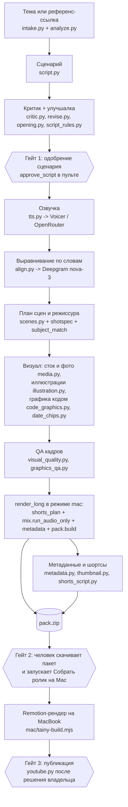

# Tainy: суть на одном экране

Источник: `/home/agent/projects/youtube-longform/tainy` (дальше `T/`), срез на 27.10.2026. Только чтение, ничего там не менялось. Документ описывает, что Tainy делает и как, чтобы перенести подход в дешёвый завод Machtwechsel (youtube-factory, ветка integrate). Предположения помечены словом «предположение».

## Что это

Tainy это автоматический конвейер «тема или ссылка на ролик-референс -> готовый длинный ролик 12-25 минут + 3-5 шортсов + обложки + название, описание, теги, закрепы». Первый канал «Тайны Древних» (русский сценарий, публикация с дубляжом на несколько языков), второй профиль `stickman` (стикмены, английский). Всё живёт на одном VPS, платные только озвучка, картинки и (частично) LLM по API. Тяжёлый рендер видео делается не на сервере, а на MacBook владельца: сервер собирает `pack.zip`, Mac рендерит Remotion (`T/render/mac/tainy-build.mjs`). Это ровно ваш случай: жена рендерит на своём MacBook, сервер только готовит пакет.

Главные идеи, которые отличают Tainy от простого «LLM написал, TTS озвучил, сток подложил»:

1. Сценарий проверяется не одной оценкой 1-10, а тремя дорожками вердикта, одна из которых это 18 бинарных письменных правил (`pipeline/script_rules.py`). Подробно в `02-SCRIPT-AND-CRITIC.md`.
2. Видео режиссируется: LLM-режиссёр раскладывает озвучку по слова-во-времени на кадры, каждый кадр имеет структурированную спецификацию (`shotspec`, `graphic_spec`), и код отбраковывает кадры, которые не совпадают со словами диктора. Подробно в `01-DIRECTION.md`.
3. Часть кадров рисуется кодом (Remotion): карты-маршруты, счётчики, шкалы масштаба, плашки с датами. Не нужны генерации и стоки, цифры берутся из озвучки. Подробно в `03-VISUALS-CODE.md`.
4. Каждый шаг с деньгами сначала считает объём и сверяет с остатком (`pipeline/budget.py`), и только потом платит.
5. Человек подтверждает три вещи: одобрение сценария, скачивание и сборка пакета на Mac, решение о публикации. Всё остальное идёт само, с перезапуском любого этапа.

## Схема этапов

Порядок стадий задан списком `jobs.STAGES` (`T/pipeline/jobs.py`): `intake, analyze, script, critic, approve_script, tts, align, scenes, render_long, shorts_plan, render_shorts, mix, metadata`. В Mac-режиме стадии `shorts_plan`, `mix`, `metadata` и сборка пакета выполняются внутри слота `render_long` (`render.run_long_mac_pack`, `T/pipeline/render.py`, строки 182-257): аудио-ветка (шортсы + микс звука) и ветка метаданных с обложками идут в двух потоках, потом `pack.build`. `render_shorts` помечается `skipped`.

## Таблица этапов

Платность: «подписка» значит списывает лимит подписки Claude Code, но не деньги по счёту. «API» значит платные кредиты Anthropic (`llm.api_first: true`, `api_monthly_budget_usd: 95` в `T/config.yaml`), после исчерпания лимит идёт на подписку. Подробные цифры в `05-COSTS.md`.

| # | Этап и модуль | Вход | Выход | Модель или сервис | Платный |
|---|---|---|---|---|---|
| 1 | Референс: `pipeline/intake.py` | ссылка YouTube, либо вставленный текст `job.transcript_text`, либо `job.topic` (тогда этап пропускается) | `ref/meta.json`, `ref/transcript.txt` | yt-dlp (субтитры ru, потом en); без субтитров Deepgram nova-3 по аудио | yt-dlp бесплатно, Deepgram центы. На сервере YouTube блокирует yt-dlp (NEXT.md 08.10), поэтому живой путь: вставить текст или режим темы |
| 2 | Разбор: `pipeline/analyze.py`, промпты `analyze.md` / `analyze_topic.md` | транскрипт или тема | `analysis.json` (тема, угол, структура, хуки, факты с проверкой) | LLM Sonnet через `llm.ask` | подписка или API |
| 3 | Сценарий: `pipeline/script.py` (+ `script_outline.md`, `script_section.md`, `script.md`) | `analysis.json`, целевая длина слов = минуты x wpm | `script_v1.json` = `script.json` (`title_working, hook, sections[], outro, sources`) | Opus (`llm.writer_model: opus`); до 4000 слов один запрос, больше пишется по главам; затем самопроверка по чек-листу | подписка или API |
| 4 | Критик: `pipeline/critic.py` | `script.json` | `scorecard.json`, версии `script_v2..vN.json` | Sonnet (тест новичка, симуляция зрителя, бенчмарк с референсом, 7 LLM-правил); Opus (deep-проход `critic.md`: оценка и переписывание целиком, точечные правки через `revise.py`, `opening.py`) | подписка или API, до двух авто-раундов (`critic_auto.max_rounds: 2`) |
| 5 | Гейт: `approve_script` в `run.py` | scorecard | `approvals.script = approved` | человек в пульте, или `auto_approve_script`, или порог `job.auto_approve_min_score` | нет |
| 6 | Озвучка: `pipeline/tts.py`, `voicer.py`, `or_tts.py`, `text_humanize.py`, `pronunciation.py` | `script.json` | `voice.wav`, чанки в `tts_chunks/` | Voicer (реселлер ElevenLabs, eleven_v4_turbo, голос Georgy); запасной OpenRouter `elevenlabs/eleven-v4-turbo`; исторически Gemini TTS | да, платно по символам |
| 7 | Выравнивание: `pipeline/align.py` | `voice.wav` | `words.json` `[{w,start,end}]`, реальный wpm в `stats.json` | Deepgram nova-3 | да, центы |
| 8 | План сцен: `pipeline/scenes.py`, `shotspec.py`, `subject_match.py`, `visual_quality.py`, `graphics_qa.py` | `words.json`, `script.json` | `scenes.json` (сцены без дыр по времени + `beats`) | LLM Sonnet (режиссёр, пакетами по 20 предложений, 8 потоков) | подписка или API |
| 9 | Визуал: `media.py`, `illustration.py`, `code_graphics.py`, `date_chips.py` | план сцен | `media/*` (фото, видео, иллюстрации), кодовые сцены в `scenes.json` | Wikimedia Commons, Wikipedia, Pexels, Pixabay (бесплатно); картинки OpenRouter `openai/gpt-image-2.5-flare` quality medium; vision-проверки через Sonnet; кодовая графика бесплатна | картинки платно (~$0.0095 за штуку), остальное нет |
| 10 | Звук: `pipeline/mix.py`, `music_analysis.py` | `voice.wav`, музыка `assets/music/*.mp3` | `audio/long.m4a` (голос + музыка, дакинг, loudnorm), `audio/shortN.m4a` | ffmpeg | нет |
| 11 | Метаданные: `pipeline/metadata.py`, `thumbnail.py`, `pinned_comments.py`, `tag_check.py`, `prefetch.py` | сценарий, главы | `metadata.json` (названия, описание с таймкодами, теги, закрепы), `thumbs/thumb1..3.png` | Sonnet; обложки тем же генератором картинок; подсказки YouTube для проверки тегов | картинки платно |
| 12 | Шортсы: `pipeline/shorts_script.py`, `shorts_visuals.py` (режим `shorts.mode: script`) | `script.json`, `scenes.json` | `shorts.json`, `shorts_scenes/shortN.json`, `audio/shortN.m4a` | Opus (выбор битов и мини-сценарии), Sonnet (фактчек, визуал), озвучка заново | озвучка платно |
| 13 | Пакет для Mac: `pipeline/pack.py` | всё выше | `pack/tainy-<id>-<slug>.zip` | zip | нет |
| 14 | Рендер: `render/mac/tainy-build.mjs`, Remotion 4 | `pack.zip` | `ролик.mp4`, `шорт1.mp4..`, обложка, `описание.txt` | MacBook владельца | нет (электричество) |
| 15 | Дубляж: `pipeline/dub.py`, `primary.py`, `localize.py` | сценарий, тайминги | `audio/long_<lang>.m4a`, переводы названий | LLM перевод с бюджетом длины + Voicer | да, озвучка по символам |
| 16 | Публикация: `pipeline/youtube.py`, `web/app.py` `/api/jobs/<id>/publish` | `final/*.mp4`, `metadata.json` | видео на YouTube | YouTube Data API v3, OAuth канала | нет |

Что в Tainy есть из лишнего для Machtwechsel (можно не переносить): дубляж на 6 языков и `primary_language`, локализация на 24 языка, радар каналов, два канала с профилями. Для дешёвого немецкого завода достаточно этапов 1-14 и 16.

## Задачи, чекпоинты и перезапуск этапа

- Одна задача это папка `T/jobs/<job_id>/` и файл `job.json` (`pipeline/jobs.py`). `job_id` = `ГГГГММДД-ЧЧММСС-<4 hex>`. Файл пишется атомарно (`os.replace` через tmp), все записи сериализованы `RLock`, потому что этапы пишут из нескольких потоков.
- В `job.json` лежат: `status` (`queued|running|waiting_approval|done|failed|cancelled`), `current_stage`, список `stages[]` с полями `name, status (pending|running|done|failed|skipped|waiting), progress, started_at, finished_at, eta_sec, message, error`, `approvals`, `outputs`, последние 80 строк `log`, `warnings`, `profile`, `pid`.
- Оркестратор `python -m pipeline.run --job <id>` (`pipeline/run.py`, `run_job`) идёт по `jobs.STAGES`, пропускает `done` и `skipped`, на ошибке помечает этап `failed` с текстом и трассировкой в log, задачу `failed`. Поэтому «чекпоинт» это сам статус этапа плюс файлы-результаты на диске: перезапуск процесса продолжает с первого не готового этапа.
- Перезапуск этапа: `jobs.reset_from(job_id, stage)` сбрасывает этот этап и ВСЕ следующие в `pending`, убивает процесс (`os.killpg`), чистит `warnings`; при сбросе `script/intake/analyze` обнуляет счётчик авто-доработки. В пульте это кнопка «перезапустить этап» (`POST /api/jobs/{id}/reset`). Внутри этапов есть свои кэши: `llm_cache.json` (ответы LLM по хэшу промпта, перезапуск не платит повторно), `tts_chunks/` и манифест озвучки, `media/ill_<hash>.png` с манифестом (готовая картинка никогда не просится снова), `shorts_work/`, `.voicer_raw/` (оплаченные ответы Voicer сохраняются до обработки).
- Запуск в фоне: `jobs.spawn_runner` стартует `agent-keys run -- python -m pipeline.run --job <id>` в отдельной сессии. Под root оборачивается в `systemd-run --unit=tainy-job-<id>-<pid> -p MemoryMax=4G`, чтобы OOM не утащил за собой службу пульта.
- Повторная попытка при лимите моделей: если обе модели вернули ошибку («both backends failed»), `run._call_stage_with_retry` ждёт 15 минут, потом 45, и повторяет этап (`LLM_RETRY_DELAYS_SEC = (900, 2700)`, добавлено 21.10 после ночных лимитов).
- Ротация: `tools/cleanup_jobs.py` по cron оставляет последние 3 готовых целиком, не трогает свежее (3 суток), без пакета держит до 14 суток.

## Профили каналов (TAINY_PROFILE)

- `util.config()` грузит `config.yaml`, а если задана переменная `TAINY_PROFILE=<имя>`, глубоко сливает поверх неё `profiles/<имя>.yaml` (словари сливаются, списки и скаляры заменяются).
- Профиль может подменять промпты: `util.prompt_path` сначала ищет `profiles/<имя>/prompts/<файл>`, иначе берёт `pipeline/prompts/<файл>`. Для списка промптов из `script.preamble_for` добавляется преамбула приоритета `profiles/<имя>/prompts/_preamble.md`.
- Профиль может добавить правила канала в промпты (`script.channel_rules_path`, плейсхолдер `{{CHANNEL_RULES}}`), отключить правила критика (`critic.rules_disabled`) и поменять веса шкал (`critic.weights`).
- Задача помнит свой профиль (`job.profile`, поле пишется при `create_job`); `run.main` перезапускается с нужной переменной, чтобы любой запуск (пульт, CLI, systemd) использовал один профиль.
- Единственный профиль сейчас `profiles/stickman.yaml` (+ `profiles/stickman/`): английский, стикмены, другой голос, шортсов нет, другая упаковка. Для Machtwechsel это готовый образец, как держать второй канал без форка кода: один `machtwechsel.yaml` и папка промптов.

## Пульт (web/)

FastAPI + одностраничник на vanilla JS без сборки (`T/web/app.py`, `index.html`, `static/js/app.js`), описание в `T/web/README.md`. Вкладки: «Новый» (ссылка, или вставка транскрипта, или тема, длина в минутах), «Очередь» (этапы, проценты, ETA, лог, кнопки «перезапустить этап», «отменить»), «Готово» (три шага: скачать пакет, выбрать обложку, взять тексты для YouTube; публикация в свёрнутом «Дополнительно»), «Настройки» (подключение YouTube, установка Mac, переводы). Карточка сценария показывает scorecard, проваленные правила и кнопки «Генерировать видео», «Улучшить по ревью», «Улучшить с комментарием», «Отклонить». Вход по паролю (cookie с подписью), слушает только 127.0.0.1 за Caddy. Опрос очереди раз в 5 секунд, без WebSocket. Основные роуты: `/api/jobs` (список, создание), `/api/jobs/{id}/reset|approve|improve|cancel|publish|thumbnail|hide`, `/mac/setup.sh`, `/mac/render.tar.gz`, `/files/{id}/{path}` с Range.

## Роль человека (гейты)

1. Одобрение сценария (`approve_script`): задача останавливается в `waiting_approval`, пока `approvals.script != approved` и `auto_approve_script: false` (так и стоит). Исключения: порог автоодобрения на конкретной задаче `auto_approve_min_score` (владелец ставил на ночь, 08.10).
2. Пакет и рендер: человек скачивает `pack.zip` и запускает на Mac «Собрать ролик». Пульт не отдаёт пакет, если основной язык не озвучен (HTTP 409).
3. Публикация: `youtube.py` вызывается только кнопкой в пульте после решения владельца; сама публикация нигде не стоит в автомате. По DIRECTION-QUALITY.md статус `done` значит «техническая сборка», а не разрешение выкладывать: факты, права на медиа и музыку проверяются отдельно.
4. Выбор обложки и названия среди трёх вариантов тоже за человеком (обложка i привязана к названию i, `CONTRACTS.md` раздел «Обложки привязаны к названиям»).

## Что читать дальше

- `01-DIRECTION.md`: как Tainy режиссирует кадры, конкретные числа и пороги.
- `02-SCRIPT-AND-CRITIC.md`: сценарий, 18 правил, критик, улучшалка. Копии промптов в `prompts/`.
- `03-VISUALS-CODE.md`: композиции Remotion, `code_graphics.py`, `date_chips.py`. Копия исходников в `render-src/`.
- `04-ORCHESTRATION.md`: склейка, LLM-вызовы, роли, Mac-пакет.
- `05-COSTS.md`: реальные расходы на ролик.
- `06-LESSONS.md`: уроки, грабли, проверки, которые ввели и почему.
