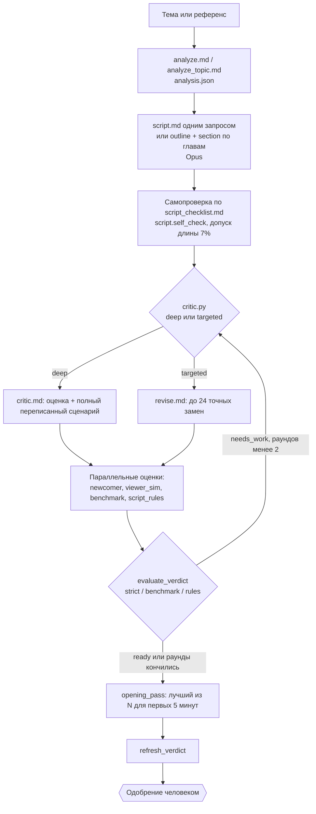

# Сценарий и критик: как Tainy пишет и проверяет текст

Источник: `pipeline/script.py`, `critic.py`, `revise.py`, `opening.py`, `script_rules.py`, `lessons.py`, `checks.py`, `text_humanize.py`, `analyze.py`, промпты в `pipeline/prompts/`, `refs/SCRIPT-PLAYBOOK.md`, `refs/SCRIPT-COMPETITOR-ANALYSIS.md`, `CONTRACTS.md` (раздел «Критик»), `config.yaml` (`critic`, `critic_auto`, `opening_pass`, `llm`, `speech`). `T/` = `/home/agent/projects/youtube-longform/tainy`.

Промпты НЕ пересказаны целиком: ниже для каждого назначение, вход, выход и 5-10 строк сути. Полный текст лежит рядом в `prompts/` (копии как есть, проверены на ключи и личные данные: в них нет ключей, есть только публичное имя канала «Тайны Древних» и его handle, при переносе заменить на Machtwechsel). Оригиналы: `T/pipeline/prompts/`.

## 1. Общая схема

Рабочие файлы: `script_v1.json` (черновик), `script_v2..vN.json` (после каждого прохода критика), `script.json` (всегда лучшая текущая), `scorecard.json`, `revision_N.json` (точный патч точечной правки), `llm_cache.json` (кэш ответов), `critic.json`.

## 2. Структура сценария

Схема `script.json`: `{title_working, hook, sections:[{id, title, text}], outro, sources:[...]}`. Хук и финал НЕ дублируются в `sections`. Текст это живая речь диктора: без маркированных списков и заголовков для озвучки, числа и годы словами там, где TTS ошибётся.

Длина: `target_words = round(minutes * wpm)`, `wpm` берётся из измеренной скорости конкретного голоса (`stats.json`, `util.get_real_wpm_blended`; по логам 120-122 слов/мин у Georgy v4 и 143-149 у второго голоса, ролик 15 минут около 1800 слов). Если цель больше 4000 слов (`CHAPTER_SPLIT_THRESHOLD_WORDS`), сценарий пишется по главам: сначала план (`script_outline.md`: хук-бриф, бриф на каждую главу), затем каждая глава отдельным запросом на свою долю слов (`script_section.md`) с хвостом из последних 40 слов предыдущей главы для связности. Причина: один гигантский ответ теряет качество к концу.

Что обязательно в структуре (из `script.md`, `script_checklist.md`, `SCRIPT-PLAYBOOK.md`):

1. Хук 20-30 секунд, 60-170 слов: в первых 2-3 предложениях прямо сказано, ЧТО за тема и В ЧЁМ загадка (понятно за 10 секунд), с парадоксом и мерой; одно главное обещание; без мета-болтовни. Правило №1 «Понятность» появилось после отзыва владельца 10.10 «первые 5 минут я ничего не понял».
2. Одна большая открытая петля, заявленная в хуке и оплаченная ближе к концу (не раньше середины), плюс малая петля на каждую главу, закрывающаяся частично.
3. Главы по схеме из 6 бит в строгом порядке: где мы и вопрос главы; официальная версия (1-2 фразы); конкретная находка (кто, когда, где, число, минимум 3 из 5); 1-2 строки явно подписанной легенды или гипотезы; твист/сомнение ОДНИМ предложением; мостик-тизер к следующей главе.
4. Мини-payoff (ответ на малый вопрос, находка, поворот) до 3-5-й минуты и ещё один до 10-й. Новый крючок, число, человек или эмоция каждые 30-60 секунд, не позже 90.
5. Первые 10 минут получают 70-90% усилий; хвост после 10-й минуты: факты, ясность, мостики, без обязательного блеска (решение владельца 11.10 по статистике: показов около 700, просмотров около 40, начало решает удержание).
6. Финал: закрыть петлю хука тем же образом, позиция в 1-2 фразы, одна живая фраза-приглашение подписаться, тизер следующего видео; без пересказа всех историй.
7. Сквозная мысль в одну фразу: в хуке, эхом в конце 3-4 глав, итогом в финале.
8. Формат «N мест/находок» предпочтителен: число названо в хуке, каждая глава знает свой номер.

Приёмы речи: короткие рубленые предложения и одно длинное на абзац; число сначала как мера и сравнение, потом цифра («гружёный вагон около шестидесяти тонн, камень весит как двести пятьдесят таких вагонов»); одно крупное число на предложение, округлять, спорные цифры одним значением с «около» одинаково во всём тексте; не больше двух новых имён на абзац; «представьте/вообразите» не более двух раз на весь сценарий; обращение на «вы» 3-6 раз; анти-тавтология (одно слово не больше 3 раз на 1000 символов).

Безопасность под монетизацию (правило 12 `script.md`): без прямых слов насилия и оружия («убийство» заменяется «загадочное исчезновение»), без медицинских советов, этнических обобщений, диффамации живых людей.

## 3. Ключевые промпты (суть)

### 3.1 `script.md` (автор), копия `prompts/script.md`
Назначение: написать новый сценарий на тему из `analysis.json`, не пересказ. Вход: `{{ANALYSIS}}`, `{{TARGET_WORDS}}`, `{{MINUTES}}`, `{{WPM}}`, `{{STRUCTURE_HINT}}`, `{{OWNER_NOTES_BLOCK}}`, `{{STYLE_SAMPLES}}` (короткие цитаты-образцы ритма из `refs/style_samples/`), `{{CHECKLIST}}` (`script_checklist.md`, в конце него подставляется `{{LESSONS}}`). Выход: JSON `script.json`. Модель: Opus (`llm.writer_model`).
Суть:
- Тон «тайна, а не разоблачение»: мини-история на каждый факт (сцена открытия, невозможная деталь, официальная версия и почему она не до конца устраивает, открытый вопрос); взгляд скептиков обязателен, но 1-2 предложения.
- Правило №1 «Понятность»: пиши для любопытного 14-летнего, который слушает один раз; сначала общая картина, потом деталь; каждый новый термин в одну фразу.
- Гибрид «реальные находки плюс легенды», легенда звучит как легенда («рассказывают, что», «по местной легенде»), выдуманную находку фактом не выдавать.
- Запрет зачинов «привет, друзья», «в этом видео»; лимит перехода-петли «но самое странное было дальше» один раз на 5 минут.
- Источники не выдумывать: не уверен в названии журнала, не называй.
- Эмоциональная дуга: любопытство, тревога, изумление, масштаб, открытый вопрос; живые реальные люди из источников, без выдуманных реплик.

### 3.2 `script_checklist.md` (24 пункта до сдачи), копия `prompts/script_checklist.md`
Это письменный стандарт владельца: пункты 1-17 накопились из отзывов (хук с человеком и парадоксом, одно обещание, число для слуха, один вопрос за раз, контекст перед деталью, реконструкция не длиннее двух предложений, оговорки дозированно, мостик, финал, первые 5 минут, призыв подписаться в конце), пункты 18-24 добавлены 16.10 по разбору хитов-референсов (хук-парадокс с мерой, сквозная мысль, формат «N мест», 3-4 вопроса зрителю вместо риторики, мостик всегда, мера в каждом абзаце, легенды мягко). Внизу блок `{{LESSONS}}` с накопленными уроками (см. 6).

### 3.3 `critic.md` (критик и, в deep-режиме, переписчик), копия `prompts/critic.md`
Назначение: оценить сценарий по шкалам и вернуть улучшенный сценарий целиком. Вход: `{{ANALYSIS}}`, `{{SCRIPT}}`, `{{CLICHE_HITS}}` и `{{SOURCE_WARNINGS}}` (результат детерминированных проверок `checks.py`), `{{IMPROVE_NOTES_BLOCK}}`, `{{OPEN5_WORDS}}`. Выход JSON: `scores{opening5, first10, hook, retention, virality, atmosphere, facts, originality, clarity}` (0-10), `strengths[<=4]`, `issues[<=8]{severity high|med|low, window 0-5|5-10|10+, text}`, `sections[]{title, score, missing, fix, montage}`, `script{...}`. Модель: Opus для переписи, оценка идёт тем же вызовом.
Суть:
- Калибровочные анкеры: «ты склонен завышать». Даны примеры хука на 9 (сцена + человек + обман ожидания + масштаб), на 8-9 (ясная тема + парадокс + обещание у хитов с 3,8 и 6,2 млн), и на 5 (абстрактный лекционный, «ставили 9, это ошибка»). Правила: 9-10 редкость, 6-7 нормальный профессиональный уровень, мета-обращение или абстракция значит hook не выше 5.
- Бенчмарк рынка: те же тексты хитов получают по шкале 5-7, поэтому «текст на 7-8 уже лучше проверенного рынком хита».
- Якоря `opening5`: 8 это пять признаков (хук-парадокс с цифрой за 15 секунд; названо число объектов; мини-награда до 3-й минуты; человек или сцена в каждой главе; ни одной главы дольше ~2,5 минут без крючка); 6-7 нет одного; 5 и ниже непонятно, скучно, перегружено.
- `clarity` судится глазами новичка; открытие с микродетали («80 рабочих тащат сани») = clarity и hook не выше 4.
- `originality` означает свежесть подачи, а не новизну темы (ремейк темы хита это стратегия канала, не штрафовать).
- Эмоции РАЗРЕШЕНЫ как явная реконструкция («можно представить, как», «наверняка дрожали руки»), не требовать их убрать.
- Требование к `severity: high`: только то, что блокирует публикацию (выдуманный факт, разоблачающий тон, нарушение safety).

Формула итога: `overall = round(sum(weight[d] * score[d]))`, веса `opening5 2.5, first10 2.0, hook 1.0, retention 1.0, virality 1.0, atmosphere 1.0, originality 0.5, clarity 0.5, facts 0.5` (сумма 10, итог 0-100, `critic.WEIGHTS`). Начало ролика даёт 45% оценки. Профиль может задавать свои веса (`critic.weights` в `profiles/stickman.yaml`: добавлены `length` и `interest`).

### 3.4 `newcomer.md` (тест новичка), копия `prompts/newcomer.md`
Вход: первые ~5 минут озвучки (число слов по реальному темпу голоса, `util.opening_words(5)`). Выход: `{what_is_video_about, understood_after_30s, confusing[], boring_spots[], score 1-10}`. Суть: «обычный зритель 14-16 лет, ничего не знает о теме, слушает один раз»; честно, не хвалить из вежливости; цитировать места, которые запутали или показались скучными; отрезок дольше минуты без нового крючка = скучно.

### 3.5 `viewer_sim.md` (симуляция зрителя), копия `prompts/viewer_sim.md`
Вход: весь сценарий, разбитый на пронумерованные секции (hook, главы, outro). Выход: по каждой секции `watch 1-10` («досмотрел бы до конца секции»), `dropoff` (цитата, где и почему ушёл бы), `fix` (одна правка ТЕКСТА диктора), плюс `first_clickaway`. Секции первых 10 минут помечены и судятся строже. Гейт: худшая секция первых 10 минут не ниже 6, хвост не ниже 5 (`RETENTION_SIM_MIN`, `RETENTION_SIM_TAIL_MIN`).

### 3.6 `benchmark.md` (слепое сравнение с референсом), копия `prompts/benchmark.md`
Вход: два текста A и B (кандидат и референс), каждый усечён до 3500 слов; какая сторона кандидат, определяется детерминированно от id задачи, модель не знает авторства. Выход: `per_dim{hook, opening5, first10, clarity, retention: A|B|tie}`, `borrow_from_A/B` (2-3 приёма, которые у текста работают сильнее), `summary`. Срабатывает только если есть транскрипт референса от 300 слов; результат кэшируется. `borrow` попадает в заметки следующей доработки.

### 3.7 `script_rules.md` + `script_rules.py` (18 бинарных правил), копии `prompts/script_rules.md`, `prompts/script_rules.py`
Назначение: убрать зависимость от «шкалы 1-10» (см. 4). 11 правил считает код по тексту, 7 судит LLM одним вызовом. Каждый ответ LLM обязан иметь `evidence` (дословная цитата в «ёлочках» 5-25 слов, проверяется по тексту; придуманная цитата делает ответ недействительным) и `fix` (одна строка, что переписать в тексте озвучки; без монтажных подсказок). Модель: Sonnet.

### 3.8 `revise.md` (точечный правщик), копия `prompts/revise.md`
Назначение: полировка без переписывания. Вход: текущий сценарий, прошлое ревью, слабые секции (<7), заметки владельца, клише, окна `{{OPEN5_WORDS}}`, `{{OPEN10_WORDS}}`. Выход: `{edits:[{path, old, new, reason}], unresolved:[...]}`. Суть: `old` встречается в поле РОВНО ОДИН РАЗ, замены не пересекаются, максимум 24 замены, замена + новые фрагменты не более 30% текста; сохранить удачные абзацы дословно, id и порядок глав, список источников; правки первых 10 минут в приоритете, после 10-й минуты только факты, ясность, сломанные мостики, длина и клише; замечания про картинку и монтаж не превращать в текст, а складывать в `unresolved`. Целый сценарий модель не возвращает, запасного пути «заменить всё» нет (`revise.py`: «No whole-script replacement fallback»).

### 3.9 `opening_rewrite.md` и `opening_judge.md` («лучший из N» для начала)
`pipeline/opening.py`: после критика и до одобрения берёт первые ~5 минут (хук + главы до `OPEN5_WORDS` слов, обрезка на границе абзаца), просит LLM 3 альтернативных переписывания ровно этого отрезка с разными углами (`ANGLES`: начать со сцены с человеком; с парадокса в 1-2 фразах; с прямого обещания и ясной загадки; с самого сильного и понятного новичку факта), параллельно, добавляет оригинал и слепым судьёй выбирает лучшее (метки перемешаны, взгляд новичка + удержание). Допуск длины `opening_pass.length_tolerance: 0.10`. Любой сбой оставляет оригинал. После применения вызывается `critic.refresh_verdict` (пересчёт правил и вердикта).

### 3.10 `scenes.md` (режиссёр), `metadata.md` (упаковка), `thumbnail_concepts.md` (обложки)
Описаны в `01-DIRECTION.md` (режиссёр, обложки). `metadata.md`: 5 названий разными конструкциями, отсортированы от лучшего; правила названия (в Tainy: КАПС, без запятых, эмодзи и декоративных символов, до 60 символов, главное слово темы в начале, одна интрига, не больше одного «?» или «:»; для немецкого канала правила нужно переписать); описание 2-4 абзаца, ключевые слова в первых 200 символах, без призыва подписаться и хэштегов (они в стандартном тексте YouTube Studio); таймкоды глав добавляет код; теги: около 30 кандидатов-запросов, которые люди реально вводят, потом проверка по подсказкам YouTube (`tag_check.py`, живые теги плюс широкие теги ниши из `config.yaml metadata.broad_tags`, сумма длин не больше 480 символов).

### 3.11 «Humanize»
В Tainy это не промпт, а код: `pipeline/text_humanize.py` (копия `prompts/text_humanize.py`). Нормализует текст перед TTS: годы и числа словами в нужном падеже («в 1349 году» превращается в «в тысяча триста сорок девятом году»), числа с единицами (метры, километры, тысячи, лет, часы), проценты (в том числе дробные), упрощение технических кодов. Рядом `pipeline/pronunciation.py` и `config/pronunciation.yaml` (словарь ударений; Gemini TTS уважал знак U+0301, ElevenLabs читает его плохо, поэтому `tts.voicer.use_accents: false`). Для немецкого TTS нужен свой аналог (числа, годы, проценты, валюты, сокращения вроде «Mrd.»).

## 4. Критик и три дорожки вердикта

Вердикт `ready` или `needs_work` вычисляет код, не LLM: `critic.evaluate_verdict(...) -> {verdict, track, blockers}`. `ready`, если проходит ЛЮБАЯ дорожка (при совпадении приоритет strict, benchmark, rules). `scorecard.verdict_track` пишет, какая сработала, `verdict_blockers` перечисляет, почему не готов.

Общие гейты дорожек strict и benchmark: нет issue с `severity: high`; шкалы `hook, retention, virality, atmosphere` не ниже 6 (`GATE_FLOOR`); `first10` не ниже 6; симуляция зрителя пройдена.

| Дорожка | Условие | Пороги (config.yaml `critic:`) |
|---|---|---|
| `strict` | общие гейты + тест новичка (score >= 8 и понял за 30 с) + `overall >= ready_overall` + `opening5 >= opening5_min` | `ready_overall: 75`, `opening5_min: 8` |
| `benchmark` | только если было сравнение с референсом: общие гейты + новичок >= `benchmark_newcomer_min` + побед больше поражений на `benchmark_min_win_margin` + `overall`, `opening5`, `hook` выше порогов | `benchmark_overall_min: 62`, `benchmark_opening5_min: 5`, `benchmark_hook_min: 7`, `benchmark_min_win_margin: 1`, `benchmark_newcomer_min: 8` |
| `rules` | только если есть `scorecard.rules`: нет проваленных critical, проваленных major не больше `rules_max_major`, нет high issue, новичок понял за 30 с и score >= `rules_newcomer_min`, симуляция зрителя пройдена, hook >= 6, референс не выигрывает (NOT `benchmark.losses > benchmark.wins`); overall, opening5 и пол шкал НЕ требуются | `rules_max_major: 1`, `rules_newcomer_min: 6`, `rules_require_newcomer: true`, `rules_enabled: true` |

Зачем три дорожки (история): 16.10 владелец заметил, что строгая планка (opening5 >= 8, overall >= 75) выше, чем проходят реальные хиты (калибровка: хиты на 2 млн просмотров получают 5-7), появилась дорожка «не хуже референса». 17.10 нечёткие шкалы упирались в 72-73 даже на хороших роликах, добавили третью дорожку по письменным бинарным правилам. Правила не ослаблялись, чтобы получить ready: на двух из трёх проверенных роликов критичный провал `hook_paradox` остался (NEXT.md 17.10).

Данные «нет» не блокируют: если тест новичка или симуляция зрителя не отработали (сбой LLM), гейты пропускаются, сбой виден в `scorecard.newcomer_error`, `retention_sim_error`. Исключение: дорожка `rules` при `rules_require_newcomer: true` (22.10) требует эти данные.

### 18 правил `script_rules` (формулировки из `RULES` в `script_rules.py`)

Код (11):
1. `hook_length` (major): хук 60-170 слов; короче нет парадокса и обещания, длиннее зритель уходит до сути.
2. `hook_measure` (major): в первых трёх предложениях хука есть число или мера (числительное или единица измерения); порядковые («девятнадцатого века») не считаются.
3. `hook_count_word` (major): если главы пронумерованы («Точка 1»), в хуке названо общее число пунктов; без нумерации не применяется.
4. `viewer_questions` (major): 3-6 прямых обращений к зрителю с призывом ответить («как вы думаете», «напишите», «в комментариях»), одно из них в финале (outro или последние 6 предложений).
5. `rhetorical_density` (minor): риторических вопросов (вне призывов к зрителю) не больше 6 на 1000 слов.
6. `chapter_length` (minor): ни одна глава, начинающаяся в первых 10 минутах, не длиннее 380 слов.
7. `bridges` (major): каждая глава, кроме последней, заканчивается мостиком (вопрос или слова перехода «но, а теперь, следующая, дальше, прежде чем») в последних трёх предложениях; допускается один промах.
8. `banned_openers` (critical): в хуке и в начале глав нет «в этом видео», «сегодня мы разберём», «привет», «добро пожаловать», «дорогие друзья».
9. `predstavte_limit` (minor): «представьте» и «вообразите» не больше двух раз за ролик.
10. `outro_subscribe` (major): в outro есть одна живая фраза-приглашение подписаться или поставить лайк.
11. `hedging_run` (minor): не больше двух предложений подряд начинаются с оговорки («возможно», «считается», «учёные предполагают»).

LLM, один вызов (7):
12. `hook_paradox` (critical): в первых трёх предложениях хука одновременно (а) ясно, о чём ролик, (б) парадокс или трещина в официальной версии, (в) конкретная мера, число или сверхстепень; живой человек или сцена не заменяют (б) и (в).
13. `through_line` (major): одна сквозная мысль в хуке, эхом в финале; финал не сводится к пересказу.
14. `terms_explained` (major): каждое новое имя, термин, топоним при первом упоминании объяснено одной фразой; необъяснённых не больше трёх на ролик.
15. `chapter_scene` (major): в каждой главе (кроме коротких до 100 слов) есть живой человек (имя или роль) или конкретная сцена.
16. `legends_honest` (critical): легенды и слухи поданы как рассказ или версия, установленный факт отделён; нет выдуманных точных дат, «очевидцев», цитат, находок; нет тона «наука скрывает».
17. `first_payoff` (major): первый мини-payoff в первых ~3 минутах озвучки (окно `PAYOFF_WORDS`).
18. `no_contradiction` (major): нет противоречий (число, дата, имя названо по-разному; вывод одной главы опровергнут другой; обещание хука нарушено финалом).

Важность: critical это то, без чего ролик не выпускаем; major допускает один промах; minor виден в списке, на ready не влияет. Проваленные правила и их `fix` попадают в заметки следующего раунда (`script_rules.rules_notes`), поэтому критик «знает», что чинить. Профиль может отключать правила (`critic.rules_disabled` в `profiles/stickman.yaml`: `viewer_questions, outro_subscribe, hook_count_word, hook_paradox, chapter_length`), потому что у другого канала другие стандарты. Тесты: `tests/test_script_rules.py`, `tests/test_critic_rules.py`.

## 5. Цикл улучшения

1. `critic.run` читает прошлый `scorecard.json` (`iteration`), считает детерминированные проверки: `checks.check_forbidden_patterns` (стоп-клише вроде «некоторые учёные считают», «по мнению экспертов», «привет, друзья», «не забудьте поставить лайк», «во-первых»; около 22 шаблонов), `check_limited_patterns` (разрешено ограниченное число раз: петля «но не самое интересное» 1 раз на 5 минут, «подождите» 2 раза, «запомните эту деталь» 3 раза), `check_sources` (регулярки типичных галлюцинаций названий источников вроде «The X Connection 2019», «Journal of ...»). Всё это попадает в промпт критика как «найдено до тебя, обязательно исправь».
2. Режим выбирает `decide_mode`: `deep` (полный переписанный проход `critic.md`) для первого прохода, при прошлом `overall < 75`, при непройденном тесте новичка, `opening5 < 6`, при high issue, при заметках владельца, просящих структурных изменений (подстроки «перепиши», «короче», «новый хук» и т. п.). `targeted` (точечные замены `revise.py`) только когда прошлый overall уже >= 75, нет high issue и заметки это полировка. Причина: точечная правка не чинит структурные проблемы; до отдельного режима «улучшения не улучшали» (NEXT.md: обнуление `prior_review` и редактор «вслепую»).
3. Параллельно оцениваются новичок, симулятор зрителя, бенчмарк, правила (кэшируются в `llm_cache.json`).
4. Guard на длину: если правка сократила текст менее чем до 80% исходника (`checks.revision_too_short`) и результат не ближе 85% к целевой длине (`near_target` в `critic.run`, чтобы осознанное сокращение раздутого черновика не откатывалось), откат к черновику прохода; точечная правка обязана держать длину ±20% (`revise.py`) и неизменные id, порядок глав и источники. Итоговый `overall` код считает сам по весам, арифметике LLM не доверяют.
5. Автораунды: `critic_auto.max_rounds: 2`, следующий раунд только если прошлый overall вырос (`run._maybe_auto_improve`); при исчерпании задача идёт на одобрение человеку с заметкой, почему не ready.
6. Человек может нажать «Улучшить по ревью» или «Улучшить с комментарием»: тот же критик, режим выбирается по `decide_mode`.
7. Если ревью сделано вручную, а не автоматическим критиком, в scorecard пишется `review_kind`, `independent_review=false`, `review_note`, и пульт явно показывает ограничение (NEXT.md 08.10).

## 6. Самообучение: уроки в промпты

`pipeline/lessons.py`: после каждого прогона критика замечания из scorecard (issues, newcomer.confusing/boring_spots, retention_sim, sections.fix) одним дешёвым LLM-вызовом сводятся к коротким кандидатам «правило: ...». Счётчик по ЗАДАЧАМ лежит в `refs/script_lessons_counts.json`; кандидат попадает в `refs/SCRIPT-LESSONS.md` только если встретился минимум в двух разных задачах. Файл (не более 1500 символов, свежие и частые первыми) подставляется в промпты сценария через `{{LESSONS}}`. Так одноразовый шум не превращается в правило.

## 7. Проверка фактов (что есть и чего нет)

Честно: полноценной проверки фактов по внешним источникам в сценарной фазе НЕТ.
- Есть: `analyze.md`/`analyze_topic.md` просят список `facts[{fact, check}]` с самооценкой уверенности модели («твёрдо известно / распространённая версия / спорно, перепроверить»), минимум 5 фактов и минимум 3 `weak_spots` (ловушки: выдумать источник, гипотезу подать как факт, клише); сама модель исследует тему «используя свои знания», веб-поиск в `analyze.py` не подключён.
- Есть: шкала `facts` в критике (вес 0.5 из 10), правило `legends_honest` (critical), правило `no_contradiction`, детерминированный `check_sources` и стоп-клише, требование не выдумывать источники, `sources[]` в `script.json`.
- Есть на экране: любая надпись, число, дата, имя в кадре обязана звучать в озвучке кадра или иметь `source_support` с цитатой из предоставленной выдержки источника (`visual_quality.unsupported_claims`, см. `01-DIRECTION.md`). Это защищает не от неверных фактов в тексте, а от НОВЫХ неподтверждённых фактов на картинке.
- Есть в шортсах: отдельный LLM-фактчек (`shorts_factcheck.md`) плюс код сверяет числа и имена мини-сценария с `script.json` по леммам (pymorphy3); сомнительный шортс отбрасывается.
- Явно сказано в проекте: «Автоматическая проверка фактов не объявлена выполненной» (NEXT.md 07.10), «проверка сценария моделью и наличие ссылки сами по себе не доказывают правильность фактов» (DIRECTION-QUALITY.md). Перед публикацией факты, права на медиа и музыку проверяет человек.
- В плане конвейера (PIPELINE-V2.md) было «факты перепроверены поиском», но в коде этапа `analyze` этого нет (предположение: не реализовано; в `analyze.py` вызова поиска нет).

Для финансового канала это главный пробел: цифры (проценты, суммы, даты решений ЕЦБ и т. п.) нужно проверять по источникам (ECB, Destatis, Bundesbank, отчёты компаний), а не по памяти модели. Это нужно добавлять поверх переносимой схемы, в Tainy такого модуля нет.

## 8. Что взять в Machtwechsel (мои выводы)

1. Писать сценарий в два шага (план + главы) для роликов длиннее ~4000 слов и держать `script_v*.json` с историей.
2. Вердикт на бинарных правилах с цитатой-доказательством вместо шкалы 1-10: 11 правил кодом (дёшево, детерминированно) + 7 одним LLM-вызовом. Переписать формулировки под финансовый канал: хук с цифрой и ставкой (деньги, риск), объяснён каждый термин (Leitzins, Inflation, Rendite), отсутствие советов «покупай/продавай» (юридический риск), честная подача мнения и прогноза.
3. Точечная правка по якорям (revise) вместо переписывания: не ломает удачное.
4. Тест новичка и симулятор зрителя как отдельные дешёвые Sonnet-вызовы.
5. Стоп-клише и лимитированные клише на немецком (аналог `FORBIDDEN_PATTERNS`).
6. Преамбула-профиль (`example_profile_preamble.md`): чтобы не форкать промпты второго канала, к общим промптам спереди добавляется блок «приоритетнее всего, что ниже» с отличиями канала; плюс отключаемые правила и свои веса шкал.
7. Самообучение по двум задачам (`lessons.py`).
