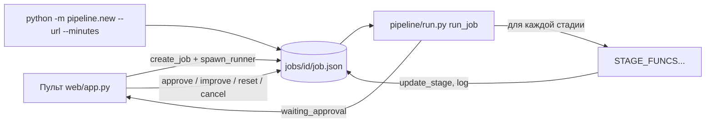

# Оркестрация: как всё склеено и как этим управляют

Источник: `T/pipeline/run.py`, `jobs.py`, `llm.py`, `util.py`, `budget.py`, `schedule.py`, `prefetch.py`, `render.py`, `pack.py`, `render/mac/*`, `CONTRACTS.md` (`T/` = `/home/agent/projects/youtube-longform/tainy`).

## 1. Принцип: файлы как контракт, этапы как чёрные ящики

Конвейер состоит из 13 стадий (`jobs.STAGES`). Каждая стадия читает файлы предыдущих из `jobs/<id>/` и пишет свои. Никакой общей базы, никакой очереди сообщений: состояние это `job.json` и набор файлов. Это делает перезапуск любого этапа тривиальным и позволяет подменять стадию, не трогая остальные.

Контракты между стадиями (из `CONTRACTS.md`, раздел «Файлы задачи»):

| Файл | Кто пишет | Кто читает | Суть |
|---|---|---|---|
| `ref/meta.json`, `ref/transcript.txt` | intake | analyze | метаданные и текст референса |
| `analysis.json` | analyze | script | `{topic, angle, structure[], hooks[], facts[{fact,check}], what_to_improve}` |
| `script.json` (+ `script_v1..vN.json`) | script, critic, revise, opening | всё дальше | `{title_working, hook, sections[{id,title,text}], outro, sources[]}` |
| `scorecard.json` | critic | пульт, run.py | оценки, issues, вердикт, дорожка, блокеры, rules |
| `voice.wav` | tts | align, mix | вся озвучка 48 кГц |
| `words.json` | align | scenes, date_chips, shorts | `[{w, start, end}]` |
| `scenes.json` | scenes | render, pack | `{fps, duration_sec, title, chapters[], words[], scenes[], sources[]}`; сцены подряд без дыр, `end[i] == start[i+1]`, у сцены `type`, `data`, `beats[{id,t}]` |
| `visual-quality.json` | scenes | человек | отчёт предполётной проверки, `ok` и `requires_review` |
| `shorts.json`, `shorts_scenes/shortN.json` | shorts_script | pack, Mac | мини-сценарии шортсов и их кадры |
| `audio/long.m4a`, `audio/shortN.m4a` | mix.run_audio_only | pack | готовый звук (голос + музыка, loudnorm) |
| `metadata.json`, `thumbs/thumbs.json` | metadata, thumbnail | pack, пульт | названия, описание, теги, закрепы; 3 обложки |
| `pack/tainy-<id>-<slug>.zip` | pack.build | Mac | всё для рендера |

Список типов сцен и их полей это тоже контракт (между режиссёром в Python и рендером в Remotion): `CONTRACTS.md`, раздел «scenes.json (контракт pipeline -> render)». Рендер версионируется хэшем исходников (`pipeline/render_version.py`), и Mac-сборщик обновляет себя, если хэш в `manifest.json` пакета отличается от установленного.

## 2. Запуск и управление задачей

- Создать: `jobs.create_job(url, minutes, topic, profile)`. Запустить: `jobs.spawn_runner(id)` стартует `agent-keys run -- .venv/bin/python -m pipeline.run --job <id>`; под root это оборачивается в `systemd-run --unit=tainy-job-<id>-<pid> -p MemoryMax=4G -p WorkingDirectory=...`. `agent-keys run --` подставляет ключи сервисов в окружение процесса. Ключи не лежат в репозитории и не печатаются.
- Вручную: `python -m pipeline.new --url URL --minutes 20 [--auto]` (`--auto` включает автоодобрение только для этого запуска).
- Одобрение сценария: `jobs.set_approval(id, "script", "approved")` + `spawn_runner`. Отклонение сбрасывает с `script`.
- Перезапуск этапа: `jobs.reset_from(id, stage)` (сбрасывает этап и все следующие) + `spawn_runner`.
- Улучшение сценария по ревью: `POST /api/jobs/{id}/improve` с заметками, сбрасывает только `critic` и дальше; `critic` тогда идёт через `revise.py` (точечные замены).
- Отмена: `jobs.cancel(id)` (SIGTERM группе процессов).
- Пульт видит «зависшую» задачу по mtime `job.json` старше 10 минут, поэтому долгие этапы обязаны периодически вызывать `update_stage(progress, message)`.

### Оценка времени (ETA)
`util.estimate_eta(stage)` берёт медиану прошлых длительностей этапа из `stats.json` (`StageTimer` пишет каждую). Реальные медианы по 20 прогонам на 27.10.2026 (`T/stats.json`, `stage_durations`): analyze 127 с, script 358 с, critic 305 с, tts 249 с (среднее 638, максимум 4142 с из-за очереди Voicer), align 6 с, scenes 1885 с (около 31 минуты, самый долгий этап), render_long 686 с (в Mac-режиме это сборка пакета, не рендер), shorts_plan 26 с, mix 28 с, metadata 29 с.

## 3. Параллельность и лимиты (числа из config.yaml и кода)

| Что | Параллельность и лимит | Где |
|---|---|---|
| Режиссура сцен (LLM-режиссёр) | пул 8 потоков (`scenes.parallel: 8`), пачки по 20 предложений (`scenes.batch_sentences: 20`) | `scenes.run`, `_direct` |
| Подбор медиа | две очереди одновременно: `ill` (иллюстрации, `illustrations.parallel: 16` + `scenes.qa_threads: 4` потока) и `photo` (поиск + vision, 8 потоков); освободившиеся `ill`-потоки крадут задачи у `photo`; `tail` (реюз из пула после `front_sec`) стартует, когда обе очереди пусты | `pipeline/schedule.py run_pipelined` |
| Vision-проверки кадров | до 12 одновременных (`scenes.vision_parallel: 12`), пачка 8 превью (`vision_batch_size: 8`) | `config.yaml` |
| Wikimedia | запросы к API строго по одному, пауза 0.5 с, бот-User-Agent с контактом (иначе вечный 429) | `media.py _WM_LOCK` |
| Озвучка Voicer | до 5 задач одновременно (лимит тарифа), все чанки видео одной-двумя пакетными задачами (ZIP), потолок 150 000 символов на задачу (лимит API 200 000), ожидание очереди до 3600 с, зависшая задача (нет прогресса 900 с) отменяется и создаётся новая | `tts.voicer.*` |
| Озвучка OpenRouter | 6 запросов, межпроцессные слоты через flock в `.or_tts_slots/` | `tts.openrouter.parallel` |
| Рендер на сервере (режим `server`) | один рендер за раз (глобальный lock `jobs/.render.lock`), `systemd-run --scope -p CPUQuota=200% -p MemoryMax=4G -p MemorySwapMax=0 --nice=10`, `--concurrency 1`; чанки по 120 с с докачкой после падения | `pipeline/render.py` |
| Рендер на Mac | `concurrency = max(2, ядра/2)`, crf 18, jpeg quality 90, h264 + aac 192k | `render/mac/tainy-build.mjs` |
| Подготовка метаданных и обложек | в фоновом потоке, пока идёт `scenes` (самый долгий этап), склейка в `metadata.run` через `prefetch.join` | `pipeline/prefetch.py` |
| Mac-режим `render_long` | ветка «шортсы + аудио» и ветка «метаданные + обложки» идут в двух потоках, потом `pack.build` | `render.run_long_mac_pack` |
| Повтор при лимитах LLM | 2 повтора этапа с паузами 15 и 45 минут | `run.LLM_RETRY_DELAYS_SEC` |
| Автодоработка сценария | не более 2 раундов (`critic_auto.max_rounds`), следующий раунд только если overall вырос | `run._maybe_auto_improve` |
| Ротация диска | `tools/cleanup_jobs.py --keep 3`, cron `tainy-cleanup` | `config.yaml cleanup:` |

Поскольку `jobs.py` пишет `job.json` из многих потоков, всё идёт через `threading.RLock` и атомарную запись; ответы режиссёра кэшируются в `llm_cache.json` (ключ = хэш промпта), поэтому перезапуск `scenes` не повторяет уже оплаченные вызовы.

## 4. Как вызываются LLM (`pipeline/llm.py`)

Единственная точка входа: `llm.ask(prompt, backend=None, timeout=900, model=None) -> (text, backend)`. Поверх неё `util.ask_json` (просит JSON, парсит `parse_json_loose`, один раз просит модель исправить невалидный JSON) и `util.ask_json_writer` (то же, но с моделью из `llm.writer_model`).

Бэкенды:
- `claude`: `claude -p --output-format text --model <sonnet|opus>` по подписке Claude Code. По умолчанию `sonnet` (`TAINY_CLAUDE_MODEL` переопределяет). Модель `opus` передают только шаги написания сценария. Длинный промпт (больше 100 000 байт) уходит через stdin, иначе Linux режет аргумент («Argument list too long», 21.10).
- `codex`: `codex exec --skip-git-repo-check --ephemeral -s read-only` (подписка ChatGPT). Был основным до 13.10.2026 (`CODEX_UNTIL`), потом по умолчанию Claude. При фразе «usage limit» в ответе пишется файл `.codex_blocked_until`, и Codex пропускается до этой даты.
- `api`: Anthropic Messages API напрямую, потоковый запрос, ключ из переменной `ANTHROPIC_CREDITS_API_KEY` (имя нарочно не `ANTHROPIC_API_KEY`, иначе сам `claude -p` перестал бы работать по подписке) и `ANTHROPIC_WORKSPACE_ID`. Модели в коде: `claude-opus-5-5`, `claude-sonnet-5-5`, `claude-haiku-5-5`.
- Порядок: `[основной, запасной]`; если задан `ANTHROPIC_CREDITS_API_KEY`, то при `llm.api_first: true` (или `TAINY_API_FIRST=1`) `api` ставится ПЕРВЫМ, иначе добавляется последним. Месячный потолок кредитов `llm.api_monthly_budget_usd: 95`: `_api_blocked()` считает расход по `logs/api_usage.jsonl` (одна JSON-строка на вызов: модель, job, input/output/cache-токены) и при достижении потолка до конца месяца идёт подписка; при ответе «credit balance» API блокируется на 24 часа (`.api_blocked_until`).
- Цены в коде для учёта (`_API_PRICES`, $ за миллион токенов вход/выход): opus 4/20, sonnet 2/10, haiku 1/5.
- `ask_vision(prompt, images)` для задач с картинками: Codex с флагом `-i` на каждую картинку, запасной `claude -p` с разрешением `--allowedTools Read` и `--add-dir` на папки картинок (модель читает файлы сама). Vision-модель по умолчанию Sonnet (`TAINY_CLAUDE_VISION_MODEL`).

Важная деталь, которая стоила времени: `stdin=subprocess.DEVNULL`, иначе `codex exec` из скрипта виснет (PIPELINE-V2.md).

### Бюджет (`pipeline/budget.py`)
Перед любой платной генерацией считается объём ВСЕГО этапа и сверяется с остатком; если не хватает, этап не стартует и пишет в `job.log` понятное русское сообщение (нужно/есть/что пополнить), трат нет. Остатки: Voicer через `GET /api/v1/user/stats` (`remaining_characters`), OpenRouter как меньшее из «лимит ключа минус расход» и «total_credits минус total_usage». Запас: 10% по символам, 15% по долларам (`budget.reserve_pct_*`). Баланс недоступен: предупреждение и работа продолжается. Проверяются: tts (символы чанков, которых нет в манифесте), dub (одна проверка на все языки), scenes (число иллюстраций без файла x цена картинки, `image_usd: 0.0095`), shorts_script. Обложки не проверяются. Отключение: `TAINY_BUDGET_OFF=1`; в unit-тестах выключено автоматически.

## 5. «Роли» в конвейере

В Tainy нет фреймворка агентов. «Роль» это пара (модуль, промпт, модель), которая получает вход как файл и возвращает JSON. Перечень, который можно переносить как роли:

| Роль | Модуль и промпт | Модель | Вход -> выход |
|---|---|---|---|
| Исследователь/аналитик | `analyze.py`, `analyze.md` / `analyze_topic.md` | Sonnet | транскрипт или тема -> `analysis.json` |
| Автор | `script.py`, `script.md`; по главам `script_outline.md` + `script_section.md` | Opus | `analysis.json` + целевая длина -> `script.json` |
| Редактор-самопроверка | `script.self_check` + `script_checklist.md` | Opus | сценарий -> тот же сценарий с минимальными правками (допуск длины 7%) |
| Критик | `critic.py`, `critic.md` | Sonnet | сценарий -> `scorecard.json` |
| Новичок | `newcomer.md` | Sonnet | первые минуты -> «понял за 30 с, оценка, где запутался» |
| Симулятор зрителя | `viewer_sim.md` | Sonnet | главы -> прогноз удержания по главам |
| Сравнение с эталоном | `benchmark.md` | Sonnet | слепое A/B с референсом -> wins/ties/losses |
| Судья по правилам | `script_rules.py` + `script_rules.md` | Sonnet | 7 LLM-правил одним вызовом + 11 кодовых |
| Правщик | `revise.py`, `revise.md` | Opus | сценарий + scorecard -> до 24 точных замен (до 30% текста) |
| «Лучший из N» для начала | `opening.py`, `opening_rewrite.md`, `opening_judge.md` | Opus (переписи), Sonnet (судья) | первые ~5 минут -> 3 варианта + оригинал, слепой выбор |
| Режиссёр | `scenes._llm_scenes_for_block`, `prompts/scenes.md` | Sonnet | предложения с таймингами слов -> сцены с типами, `shot_spec`, `graphic_spec`, `beats` |
| Подборщик визуала | `media.py` + vision | Sonnet (vision) | запросы режиссёра -> лучшее фото/видео + bbox аннотаций |
| Иллюстратор | `illustration.py` + `shotspec.py` | gpt-image-2.5-flare | `shot_spec` -> PNG |
| Графический ассистент | `code_graphics.py` | Sonnet + vision | сцены и слова -> карты, счётчики, callout, зум |
| QA кадров | `visual_quality.py` (код), `graphics_qa.py` (still + vision), `render.run_visual_qa` | код + Sonnet vision | сцены -> отчёт, отбраковка |
| Упаковщик | `metadata.py`, `metadata.md`; `thumbnail.py`, `thumbnail_concepts.md`; `pinned_comment.md`; `tag_check.py` | Sonnet + генератор картинок | сценарий -> названия, описание, теги, обложки |
| Автор шортсов | `shorts_script.py` (`shorts_beats.md`, `shorts_write.md`, `shorts_factcheck.md`, `shorts_visual.md`) | Opus (биты, тексты), Sonnet (фактчек, визуал) | сценарий -> 3-5 мини-сценариев |
| Самообучение | `lessons.py` | Sonnet | замечания критика -> правила в `refs/SCRIPT-LESSONS.md` (попадают в промпты автора через `{{LESSONS}}`, только если встретились минимум в двух разных задачах) |

Подробнее про промпты автора и критика в `02-SCRIPT-AND-CRITIC.md`, про режиссёра в `01-DIRECTION.md`.

## 6. Где человек подтверждает

1. `approve_script`: задача останавливается в `waiting_approval`. Перед остановкой `run.py` пробует: до 2 раундов автодоработки (`_maybe_auto_improve`), затем `opening_pass` и пересчёт вердикта (`critic.refresh_verdict`). Кнопки в пульте: «Генерировать видео», «Улучшить по ревью», «Улучшить с комментарием», «Отклонить», ручная правка текста.
2. После сборки пакета человек скачивает `pack.zip` (пульт отказывает с 409, если основной язык не озвучен) и запускает на Mac «Собрать ролик».
3. Публикация: кнопка в пульте (`youtube.py`), приватность и дата отложенной публикации выбираются человеком.
4. Обложка и название: человек выбирает вариант из трёх.

## 7. Mac-пакет и рендер на MacBook

Режим включается `render.target: mac` (`config.yaml`, строка 156; профиль stickman тоже `mac` с комментарием «жена рендерит на своём MacBook тем же Mac-скриптом (pack.zip из пульта)»). В этом режиме сервер НЕ рендерит видео вообще: `render.run_long` вызывает `run_long_mac_pack`. Сервер тянет только лёгкое: LLM, озвучку, картинки, звук, пакет.

### Что в `pack.zip` (`pipeline/pack.py`, docstring и `build`)
- `scenes.json`: план сцен, пути медиа относительные (`media/...`), никаких абсолютных путей. Перед упаковкой `_drop_null_optionals` убирает null-поля, а `_render_check` прогоняет `render/scripts/check-scenes.mjs`.
- `media/**`: ТОЛЬКО файлы, на которые реально ссылается `scenes.json` (`data.src` и все `data.shots[].src`) и `shorts_scenes/*.json`. Сжатие медиа внутри `pack.py` не делается (поиск по `jpeg|compress` в файле пусто); идея «иллюстрации в JPEG, стоки сильнее сжать» записана в NEXT.md (08.10, задача 3) как нерешённая, оценка размера 60-120 МБ на 20 минут, пакет пилота 35 секунд весил 21,6 МБ. Реальные пакеты 22-25-минутных роликов с дубляжом весят 285-414 МБ, один 512 МБ (`05-COSTS.md`, раздел 5): учитывайте при передаче на MacBook.
- `audio/long.m4a` (голос + музыка, loudnorm, без видео), `audio/shortN.m4a`; при дубляже `audio/long_<lang>.m4a`.
- `shorts.json`, `shorts_scenes/shortN.json` (для шортсов-мини-сценариев).
- `thumbs/thumb1..3.png`, `metadata.json`, `metadata.txt` (человекочитаемая выжимка: 5 названий, описание с таймкодами, теги, шортсы, закрепы), `metadata_ready.txt` при не русском основном языке.
- `manifest.json`: `{job_id, title, slug, render_version, fps, created_at, chosen_thumb, [primary_language, primary_ready, primary_shorts_ready], [shorts_mode, shorts_scenes], [render_only]}`.
- Сборка идёт во временный `*.zip.tmp` и подменяется `os.replace`; старые zip этой задачи с другим slug удаляются.

### Что делает `render/mac/`
- `setup.sh`: разовая установка и обновление на Mac. Проверяет Node.js 20+, спрашивает адрес пульта и токен доступа (кладёт в `~/Tainy/dashboard.conf`, права 600), скачивает `render.tar.gz` с пульта (`/mac/render.tar.gz?token=...`), атомарно подменяет `~/Tainy/render`, делает `npm ci`, готовит браузер Remotion для mac-arm64. Кладёт на рабочий стол ярлык «Собрать ролик.command» (`exec node ~/Tainy/render/mac/tainy-build.mjs`); готовый `tainy-*.zip` кладётся в «Загрузки», двойной клик по ярлыку запускает сборку.
- `tainy-build.mjs`: читает `pack.zip` (или распакованную папку), сверяет `manifest.render_version` с установленной (`~/Tainy/.render_version`) и при расхождении обновляет рендер с пульта; проверяет `primary_ready` и останавливается с кодом 2, если пакет собран без озвучки основного языка (защита от русского ролика вместо немецкого, 22.10); собирает bundle (`@remotion/bundler`, `src/index.ts`), раскладывает медиа и аудио, рендерит `Main` через `renderMedia` (h264, crf 18, jpeg 90, aac 192k, `gl: angle` с откатом на `swiftshader`), потом шортсы по `shorts_scenes/shortN.json`, потом копирует обложки и пишет `описание.txt`. Прогресс в лог и в уведомление macOS.
- Результат на Mac: `ролик.mp4`, `шорт1.mp4...`, `обложка.png` и остальные превью, `описание.txt`. Скорость полного 15-20-минутного рендера на Mac в файлах не измерена (в NEXT.md 08.10 остался пункт «проверить скорость M4»); известно, что на сервере 33-секундный пилот рендерился 6 мин 23 с при concurrency 1 (NEXT.md 07.10), а первая сборка на Mac 08.10 отработала («работает!», ролик 27,8 МБ на тестовом пилоте). Из этого скорость длинного ролика на M4 предположение, не факт.
- Обновление рендера доставляется через пульт: версия = хэш исходников (`render_version.py` хэширует `render.mjs`, `package.json` + lock, `src/`, `lib/`, `scripts/`, `mac/`).

### Что это значит для вас (жена рендерит на MacBook)
Серверу дешёвого завода тяжёлый рендер не нужен. Нужны: (1) `pack`-формат (zip с `scenes.json`, `media/`, аудио, манифест), (2) `tainy-build.mjs` и `setup.sh` как есть (после правки текстов и путей), (3) отдача `render.tar.gz` из вашей админки или вручную копией папки `render/`. Исходники Remotion-композиций Tainy скопированы в `render-src/` (см. `03-VISUALS-CODE.md`).

## 8. Расписание и фоновые процессы

- `tools/localize_watch.py` (cron `/etc/cron.d/tainy-localize`, раз в час в :17) переводит название и описание вышедших роликов на 24 языка. Не нужно для Machtwechsel.
- `tools/cleanup_jobs.py` (cron `tainy-cleanup`) ротация задач.
- `pipeline/dub.py` в фоне после сборки пакета (если `dub.enabled`).
- Планировщик публикации не автоматизирован: решение о выкладке всегда за человеком.

## 9. Тесты

`T/tests/` содержит 50+ офлайн-тестов (unittest, pytest не нужен): `python -m unittest discover -s tests -v` (запускать от пользователя agent). Сетевые вызовы (Voicer, OpenRouter, vision, LLM) в тестах подменены. Тесты пульта `tests/test_*.cjs` идут в Chromium с замоканной сетью. Количество на 07.10.2026: 128 тестов (65 direction/media + 4 frame-timing + 58 renderer + 1 регрессия), NEXT.md.

## 10. Что взять в дешёвый завод (мои выводы)

1. Паттерн «стадия = функция над папкой задачи + `job.json` со статусами + `reset_from`» берётся целиком; это 6,7 КБ кода (`jobs.py`) и 11 КБ (`run.py`).
2. Единая точка LLM-вызова с цепочкой (подписка, API, запасной) и JSON-парсером с самолечением: `llm.py` + `util.ask_json`.
3. Предпроверка денег (`budget.py`): дёшево и спасает от полутрат.
4. Двухпоточный Mac-режим и пакет `pack.zip`: рендер вынесен на MacBook, сервер лёгкий.
5. Фоновая подготовка метаданных и обложек параллельно с самым долгим этапом (prefetch).
